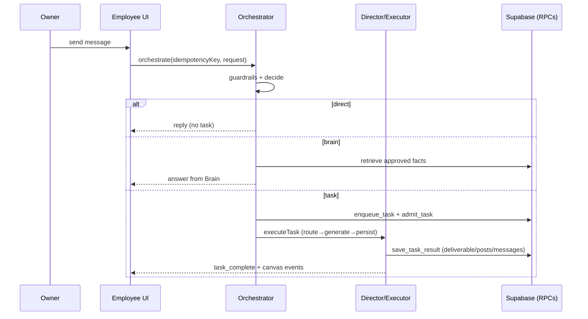
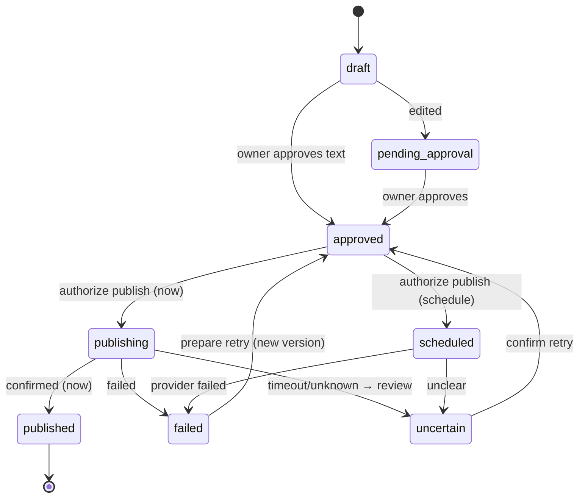
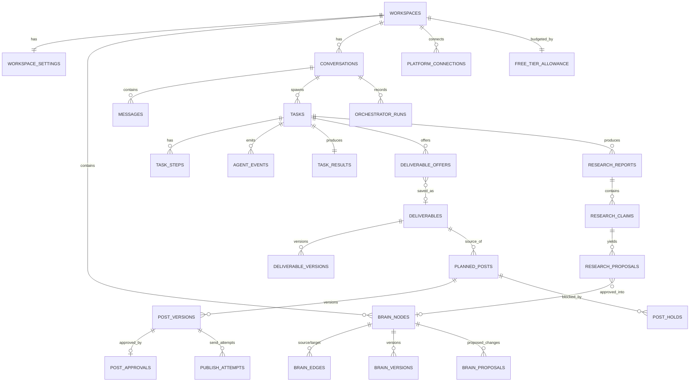
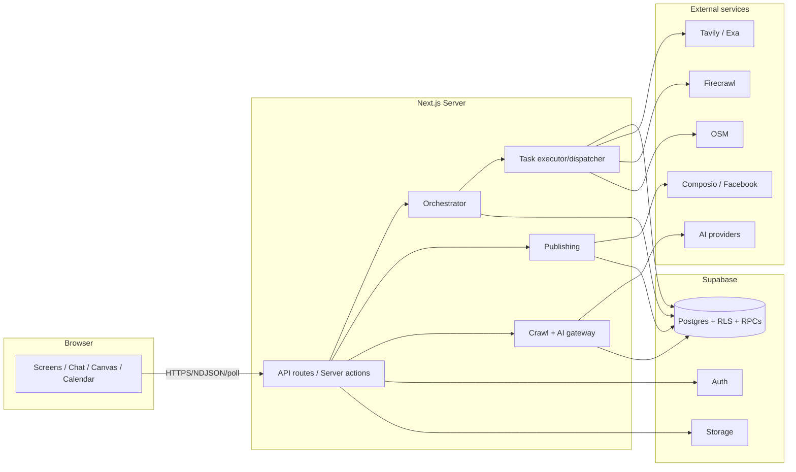

# Busmora — Project Context

> **Purpose of this document.** This is a business-first and architecture-second knowledge base for an AI partner (Business Analyst / Product Strategist / Business-Logic Designer / Technical Consultant) who will **not** have access to the source code. It explains *what the product does, why, how its business processes work, and how the technical pieces fit together*, so that partner can reason about features, edge cases, and dependencies, and produce implementation prompts for a coding agent.
>
> **Confidence labels used throughout:**
> - **[Verified]** — directly supported by the current code/migrations.
> - **[Inferred]** — strongly implied by the implementation but not stated explicitly.
> - **[Unknown]** — cannot be established from the repository.
>
> Every important claim carries a repository path (and often a line reference) so it can be verified later. Nothing here exposes secret values — only environment variable *names*.

---

## A. Project Overview

### What this product is

**Busmora** is a web application that acts as an **AI Marketing Director for small-business owners**. The owner teaches the system about their business once (their "Business Brain"), and thereafter either (a) **chats with an AI marketing employee** to get marketing work done (market research, competitor analysis, social posts, campaigns, performance diagnosis), or (b) follows a **guided Roadmap** toward a business goal. The product is **Egyptian-first** (Arabic/English, Egypt market data, Egyptian pricing conventions) but the interface is currently **English-only**. **[Verified]**

The product tagline from the marketing site: *"Marketing, made clear. Your AI Marketing Director. Understand your priorities, prepare the work, and stay in control."* (`src/features/marketing/model/messages.json`) **[Verified]**

### What problem it solves

Small-business owners typically lack a marketing team, marketing expertise, and time. Busmora aims to give them an always-available "marketing director" that: understands *their specific* business, proposes a practical next step, and prepares real deliverables (research reports, competitor comparisons, post drafts, content calendars) that the owner **reviews and approves before anything goes live**. It emphasizes *owner control* and *no invented data* over automation. **[Verified]**

### Who the target users are

- **Primary user: the business owner** of a small or medium business (shops, e-commerce, professional services, restaurants, real estate, education, health, SaaS, FMCG, etc. — see the 10 "golden industries" in `src/features/research/golden/index.ts:20-91`). **[Verified]**
- The system is **single-user-per-workspace**: each account = one private workspace containing that owner's business. There is **no staff/team/multi-seat concept** in the code. **[Verified]**

### Value provided

1. **One-time business context capture** (website crawl or manual form) that becomes reusable "knowledge." **[Verified]**
2. **Evidence-based research** with citations, so the owner can trust (and verify) findings. **[Verified]**
3. **Concrete deliverables** (reports, post drafts, calendars) rather than vague advice. **[Verified]**
4. **Owner-approval gate** on everything consequential (publishing, Brain updates from research). **[Verified]**
5. **Free-tier-only operation** — the system will not spend money on the owner's behalf (no paid ads, no paid API fallback). **[Verified]**

### Main business objectives (as evidenced)

- Reduce the gap between "I have a business" and "I have marketing work ready to review."
- Keep a human in the loop for every consequential action (approval-first).
- Build trust through citations, confidence levels, and explicit unknowns.
- Contain cost (free-tier research budgets, no paid fallback). **[Verified]**

### Overall product concept

A single authenticated **workspace** per owner, with:
- a **Business Brain** (approved business-knowledge graph),
- a **Marketing Director chat** (the "Employee") that routes every message through an **Orchestrator**,
- a **Roadmap** (guided Discovery wizard to a goal),
- **Deliverables** (document library),
- **Scheduling/Calendar** (content + Facebook publishing with two-step approval),
- **Settings** (account, region, BYO AI key, Facebook page). **[Verified]**

### Primary use cases

1. **Onboard**: point Busmora at your website (or fill a form) → get a starter Brain. **[Verified]**
2. **Chat**: "Do market research on X", "Analyze my competitors", "Write 5 social posts", "Create a content calendar." **[Verified]**
3. **Follow a Roadmap**: pick a goal ("win first customers") → answer guided questions → get a plan. **[Verified]**
4. **Review & publish**: approve a post's text, then Publish now or Schedule via Facebook. **[Verified]**
5. **Ask the Director what it knows about the business** ("what do you know about me?") → answers from the Brain. **[Verified]**

> **Product status:** The product is explicitly labeled **"in development"** across the marketing site, pricing, and footer. Pricing is **"to be announced."** See Section L.

---

## B. Business Model & Product Structure

### How the business operates (as far as the repo establishes)

- Busmora is delivered as a **single-tenant SaaS-style web app**. Each owner gets one private workspace. **[Verified]**
- **Monetization is not yet implemented.** There is a **plan concept** (`workspace_settings.plan` ∈ `starter|growth|scale`, default `starter`) and a marketing pricing page with three illustrative tiers (Starter / Growth / Director), but **all prices are "To be announced" and the plans are explicitly labeled "PROPOSED PLAN" / illustrative** (`src/features/marketing/ui/Pricing.tsx:56-81`, `messages.json:208-243`). **[Verified]**
- There is **no payment/billing/subscription code**, no checkout, no invoicing. The pricing page FAQ explicitly says *"Can I subscribe today? No — product in development."* **[Verified]**
- The only real "cost control" mechanism is the **free-tier research allowance** (a rolling 24-hour budget of provider calls/pages/tokens/credits) and a **BYO-AI-key** option. There is **no paid fallback** anywhere. **[Verified]**

> **Do not invent a business model.** Based on the repository: the intended model is *presumably* a subscription SaaS (tiered plans), but the actual billing logic, prices, and limits are **not implemented**. Treat monetization as **planned but unbuilt**. **[Verified]** for status; **[Inferred]** for the eventual intent.

### Main product components

| Component | Route | What it is |
|---|---|---|
| Marketing site | `/[lang]` | Public landing page, product story, illustrative pricing, guest demo anchor. |
| Auth | `/[lang]/(auth)/signin,signup,reset,auth/new-password` | Email/password + Google OAuth; password recovery. |
| Onboarding | `/[lang]/onboarding` | Capture business context (website crawl or manual form) → seed Brain. |
| Employee (Marketing Director) | `/[lang]/(workspace)/employee` | Chat with the AI Director + live Agent Canvas. |
| Roadmap | `/[lang]/(workspace)/roadmap` | Discovery wizard toward a business goal. |
| Brain | `/[lang]/(workspace)/brain` | Business knowledge graph: nodes, relationships, review, evidence. |
| Scheduling/Calendar | `/[lang]/(workspace)/scheduling` | Content calendar, post approval, Facebook scheduling/publishing. |
| Deliverables | `/[lang]/(workspace)/deliverables` | Saved document library with versioning. |
| Settings | `/[lang]/(workspace)/settings` | Account & region, BYO AI key, Facebook page connection. |

All six workspace destinations appear in the sidebar/bottom nav (`src/components/AppShell.tsx:25-32`). **[Verified]**

### Relationship between modules

- **Brain is the hub.** Onboarding seeds it; research proposes additions to it; the Director chat reads from it to answer "what do you know about me?"; the Discovery wizard reuses approved Brain facts to prefill/skip questions; and deliverables/posts record **dependencies on Brain node versions** so that if a fact changes or is deleted, dependent content is flagged stale or held. **[Verified]** (see `context_dependencies`, `mark_brain_context_changed` in `supabase/migrations/20261118025000_brain_governance.sql`).
- **Tasks flow through the Orchestrator.** Every user message in the Employee chat is classified by the Orchestrator into *direct answer*, *brain answer*, or *task* (hand-off to a research/content/campaign/diagnosis pipeline). **[Verified]** (`src/features/orchestrator/*`).
- **Deliverables come from tasks.** Chat output can be saved as a Deliverable (via an explicit "Save this?" offer), and deliverables can be continued in chat ("Continue with Director") as a new task. **[Verified]**
- **Posts flow from tasks → Calendar → Facebook.** Generated posts become draft `planned_posts`; the owner approves the text, then schedules/publishes via Facebook. **[Verified]**

### How users interact with the product

Primarily through **chat** (natural language) and **forms/wizards** (onboarding, discovery, settings), plus **review surfaces** (Brain review, Deliverables, Calendar approvals). The chat is polled every ~1.8–2.5 s for near-real-time agent progress (no websockets). **[Verified]**

### Revenue-generating mechanisms

**None implemented.** See "How the business operates" above. Plan tiers exist only as a data field and illustrative marketing content. **[Verified]**

### Customer-facing vs internal-facing features

- **Customer-facing**: all workspace screens + marketing site.
- **Internal/operational**: BYO AI key management (encrypted server-side), service-role-only RPCs (publishing claims, usage reservation), server-owned prompts, the free-tier allowance ledger, and the acceptance/golden evaluation harness (used for quality assurance, not exposed to owners). **[Verified]**

---

## C. User Types, Roles & Permissions

### There is exactly one real user role: the **Workspace Owner**

The system is single-user-per-workspace. There is **no admin vs customer, no staff, no vendor, no manager distinction** in the code or schema. Every authenticated user owns exactly one workspace (id = `auth.users.id`). **[Verified]**

### What the owner can do

- Manage their **business context** (onboarding draft, Brain knowledge, region preferences). **[Verified]**
- **Chat** with the Marketing Director and create tasks. **[Verified]**
- **Review, edit, approve, reject** Brain nodes/edges, deliverable edits, post approvals. **[Verified]**
- **Connect/disconnect** one Facebook Page and **schedule/publish** posts. **[Verified]**
- **Manage their own AI key** (BYO key, stored encrypted server-side). **[Verified]**
- Read their own **audit log**. **[Verified]**

### What the owner cannot do

- Cannot access any other workspace's data — enforced by **RLS** (`workspace_id = auth.uid()` on every table) and by every RPC scoping on `auth.uid()`. **[Verified]**
- Cannot write most business tables directly — writes go through **`SECURITY DEFINER` RPCs**. Direct INSERT/UPDATE/DELETE on `tasks`, `brain_nodes`, `brain_edges`, `planned_posts`, `research_proposals`, `platform_connections`, `workspace_settings` (most columns), etc. have been revoked. **[Verified]**
- Cannot publish without completing the **two-step approval + schedule/publish** flow. **[Verified]**
- Cannot force research findings into the Brain except through the **approval RPC**. **[Verified]**

### Permission model in detail (conceptually)

| Capability | How it's enforced |
|---|---|
| Read own data | RLS policies `USING (auth.uid() = workspace_id)` |
| Write business data | `SECURITY DEFINER` RPCs granted to `authenticated`, validating ownership + version |
| Sensitive ops (publish claim, usage reservation, credentials, connection upsert) | `service_role` only (browser cannot call) |
| Connection metadata | Server-owned; client has read access only |
| AI credentials | Encrypted (`pgp_sym_decrypt` with `app_secrets.ai_key_root`); client may **submit** a key but never read plaintext |

Sources: `supabase/migrations/20261017171908_busmora_core_schema.sql`, `20261118021000_server_credentials.sql`, `20261118024000_workspace_preferences.sql`, `20261119035000_workspace_settings_setup_state_lock.sql`. **[Verified]**

### "Actor" concept

`audit_log.actor_id` records who performed an action (added in `20261118020000_competition_contracts.sql:13`). In practice this is always the owner. **[Verified]**

### Relationship with other "user types"

There are **no other user types**. The "Marketing Director," "Research Director," and named research agents are **AI system components**, not users (see Section D and the Glossary). **[Verified]**

---

## D. Complete Feature Inventory

> Grouped by module. Status refers to **verified implementation** (see Section L for the status legend).

### Module 1 — Marketing Website (public)

| Feature | Purpose | User | How it works | Rules / notes | Status |
|---|---|---|---|---|---|
| **Landing page** | Tell the product story and convert visitors. | Guests / owners | Scroll scenes, feature sections, process flow, testimonials, FAQ, footer. | Auth-aware CTA (Login/Get Started vs Dashboard). | Implemented |
| **Product tour / interactive tabs** | Show Director Chat, Brain, Calendar screenshots. | Guests | Static tabbed screenshots. | — | Implemented |
| **Pricing page** | Communicate (future) plans. | Guests | Three illustrative tiers (Starter/Growth/Director), monthly/yearly toggle, comparison table. | All prices/limits = "To be announced"; no checkout. | Implemented (illustrative) |
| **Pricing FAQ** | Answer objections. | Guests | Static Q&A. | States: no marketing experience needed, website optional, English, no auto-publish/spend, cannot subscribe yet. | Implemented |
| **Guest demo** | Let guests try the product. | Guests | Hero CTA scrolls to `#product-demo` (the tabs section). A richer `InteractiveDemo` exists but is **not imported** (dead code). | — | Partial (anchor only) |
| **i18n / RTL** | Arabic + English. | All | Locale-prefixed routes `/[lang]/...`, default `ar` (RTL), cookie-remembered. | Workspace content is English-only; UI supports both. | Implemented |

Sources: `src/features/marketing/*`, `src/app/[lang]/page.tsx`, `src/context/I18nContext.tsx`, `src/lib/i18n.ts`. **[Verified]**

### Module 2 — Authentication

| Feature | Purpose | How it works | Rules | Status |
|---|---|---|---|---|
| **Sign up** | Create account. | Email+password (min 8) or Google OAuth. | → `/onboarding`. | Implemented |
| **Sign in** | Authenticate. | Email+password or Google. Honors `?next=` safe redirect. | Signed-in users are redirected away to `/employee`. | Implemented |
| **Reset password** | Recover account. | Emails a recovery link → `/auth/callback?flow=recovery`. | — | Implemented |
| **New password** | Set new password. | After recovery link; routes to `/employee` or `/onboarding`. | — | Implemented |
| **Auth callback** | OAuth/recovery code exchange. | Exchanges code, bootstraps workspace, routes onward. | — | Implemented |
| **Route protection** | Keep private pages private. | Server-side `requireWorkspace()` redirects to `/signin` or `/onboarding`. | Open-redirect protection via `safeReturnPath()` allow-list. | Implemented |
| **Auth context** | Client session state. | `AuthContext` subscribes to `onAuthStateChange`, detects `PASSWORD_RECOVERY`, reloads settings. | — | Implemented |

Sources: `src/screens/auth/*`, `src/context/AuthContext.tsx`, `src/server/auth.ts`, `src/lib/authRouting.ts`, `src/app/auth/callback/route.ts`. **[Verified]**

### Module 3 — Onboarding

| Feature | Purpose | How it works | Business rules | Status |
|---|---|---|---|---|
| **Choose method** | Start setup. | Three options: **Website**, **Manual**, **Social import (disabled, "Coming soon")**. | — | Implemented (social disabled) |
| **Website path** | Auto-capture business context. | Enter URL → crawl up to 3 public pages → AI extracts candidates → map onto editable draft → organize Brain with AI. | URL must be a real host (not email); fields the site supports are merged without blanking owner edits; on failure reverts to `awaiting_url`. | Implemented |
| **Manual path** | Enter business details. | `BusinessForm`: name, what you do, offerings (1–20), country + service area, conversion route, optional brand tone/color. | Save draft or Finish setup; version-checked. | Implemented |
| **Draft safety** | Don't lose work. | Versioned draft with `expected_version`; stale save → `STALE_VERSION` → reload. | Owner-confirmed only. | Implemented |
| **Completion** | Mark setup done. | On success: state `complete`, show pages-read + facts-collected, offer "Contact the Director" or "Select a Plan." | `confirm_business_draft` sets `onboarding_state='complete'`. | Implemented |

Sources: `src/screens/Onboarding.tsx`, `src/features/onboarding/*`, `supabase/migrations/20261118022000_business_confirmation.sql`, `20261119040000_onboarding_state_rpc.sql`. **[Verified]**

### Module 4 — Marketing Director Chat ("Employee")

| Feature | Purpose | How it works | Business rules | Status |
|---|---|---|---|---|
| **Conversations** | Threaded chat. | Per-workspace conversations; last active restored from `localStorage` or `?conversation=`; history drawer with new/select/delete. | First message sets conversation title. | Implemented |
| **Send message → Orchestrator** | Understand & route. | `runner.orchestrate()` → server Orchestrator classifies intent (direct / brain / task). | Idempotency key prevents double-processing. | Implemented |
| **Quick prompts** | Onboarding to chat. | "Do market research", "Analyze my competitors", "Write 5 social posts", "Create a content calendar." | — | Implemented |
| **Live progress card** | Show agent work. | Derived from agent events (Orchestrator / Research Director / Content Writer / Campaign Planner / Performance Analyst), current step + last 3 steps. | Polled ~2.5s. | Implemented |
| **Agent Canvas** | Transparent "how the AI reached this answer." | React Flow graph built from persisted agent events; node kinds user/orchestrator/director/subagent/tool/skill/auditor/synthesis; state pills; inspector. | Node positions persisted per conversation in localStorage. | Implemented |
| **Message types** | Rich results. | text, deliverable_card (with post grid or doc card), deliverable_offer (Save/Not now), post_reference (FB preview), form/structured_form (question wizard), budget_extension_request, knowledge_notification, task_status, error. | Legacy forms render read-only. | Implemented |
| **Question wizard** | Ask a clarifying question. | Structured form with choice chips + free text + unknown/skip/not-applicable; submitting resumes the waiting task. | Only one pending input per task. | Implemented |
| **Deep links** | Continue work. | `?task=`, `?compose=&document=&version=` prefill composer and mark document continuation. | — | Implemented |

Sources: `src/screens/EmployeePage.tsx`, `src/features/tasks/*`, `src/features/orchestrator/*`, `src/components/chat/*`, `src/lib/chatCanvasStorage.ts`. **[Verified]**

### Module 5 — Business Brain

| Feature | Purpose | How it works | Business rules | Status |
|---|---|---|---|---|
| **Graph view** | Visualize knowledge. | Hub-and-spoke: central company profile, category pills, leaf knowledge cards, dashed labeled edges. Deterministic layout. | Status/category filters, search, minimap >6 nodes. | Implemented |
| **List view** | Review & edit. | Filter tabs (All/Approved/Pending), search, category dropdown; candidate cards vs approved groups. | — | Implemented |
| **Candidate review** | Approve crawler/task facts. | Approve/reject/edit/evidence; bulk Approve all / Reject all. | `update_brain_item` / `decide_brain_proposal`. | Implemented |
| **Proposal review** | Approve proposed *changes*. | Diff view + base-version guard; Approve / Edit & approve / Reject. | `decide_brain_proposal` with optimistic concurrency. | Implemented |
| **Research proposal review** | Approve research findings. | Typed findings (market fact / competitor / audience insight / positioning claim / price observation / opportunity hypothesis) with confidence + evidence + geography. | Only `decide_research_proposal` creates research-backed nodes. | Implemented |
| **Editing** | Maintain knowledge. | `NodeEditor` (title/summary/category/pricing), `RelationshipEditor` (5 relation types), delete with confirm. | Amount+currency validation; delete cascades edges + holds dependent posts. | Implemented |
| **Evidence panel** | Show provenance. | Origin, statement type, updated, confidence, source URL, evidence quote, full version history. | — | Implemented |
| **Reorganize with AI** | Re-crawl & re-organize. | Re-reads saved `company_url`, re-organizes Brain. | Additive; never overwrites owner edits. | Implemented |
| **Audit log** | Transparency. | Last 50 audit rows. | Append-only. | Implemented |

Sources: `src/screens/BrainPage.tsx`, `src/components/brain/*`, `src/server/workspace-data.ts`, `src/lib/brainGraphLayout.ts`, `20261118025000_brain_governance.sql`. **[Verified]**

### Module 6 — Roadmap (Discovery wizard)

| Feature | Purpose | How it works | Business rules | Status |
|---|---|---|---|---|
| **Goal picker** | Choose objective. | Six goals: win first customers / grow customers / convert inquiries / launch an offer / increase repeat/referral / something else. | Choosing a goal saves a draft and generates a question plan. | Implemented |
| **Adaptive questions** | Gather what's missing. | Deterministic planner reuses eligible Brain facts to prefill/skip; missing info becomes explicit questions or explicit "unknown." | Goal-specific branches (first-customer route, growth motion, inquiry breakpoint, launch scope, repeat trigger). | Implemented |
| **Question cards** | Answer flexibly. | Choice options (some sourced from Brain, badged), "other" free text, long text, statuses Not sure / Skip / Not applicable / Clear answer. | Autosave with debounce + manual Save. | Implemented |
| **Progress sidebar** | Track completion. | Answered/total, "From your brain" facts used, open unknowns, "Preliminary plan" action. | "Preliminary plan" does not generate a roadmap. | Implemented |
| **Concurrency safety** | Protect across tabs. | Expected-version checks; conflict → "Load latest" vs "Save mine over it." | `beforeunload` warns on unsaved. | Implemented |
| **Goal change** | Preserve earlier answers. | Changing goal keeps earlier answers under "Saved earlier answers"; can restore a prior goal. | — | Implemented |

Sources: `src/features/roadmap/*`, `src/screens/RoadmapPage.tsx`, `20261119014000_adaptive_discovery.sql`. **[Verified]**

### Module 7 — Deliverables

| Feature | Purpose | How it works | Business rules | Status |
|---|---|---|---|---|
| **Document library** | Browse outputs. | Searchable/filterable list; types research_report / competitor_analysis / content_posts / content_calendar / performance_diagnosis / general. | Cursor pagination. | Implemented |
| **Save offer** | Bridge chat → library. | Substantial chat output creates a `deliverable_offers` row + `deliverable_offer` card; owner Save / Not now. | One offer per type per task; save is idempotent. | Implemented |
| **Viewer** | Read & act. | Markdown render, type/version/origin/timestamps/staleness, version selector. Actions: Edit, Copy, Download .md/.txt, Reuse, Continue with Director, Delete. | Older versions read-only; Edit creates new version. | Implemented |
| **Origin labels** | Provenance. | Saved from chat / document / discovery / roadmap step. | — | Implemented |
| **Versioning** | History. | Immutable `deliverable_versions`. | Expected-version guard on edit/delete. | Implemented |

Sources: `src/screens/DeliverablesPage.tsx`, `src/lib/deliverableRouting.ts`, `src/lib/deliverableMarkdown.ts`, `20261119013000_document_library.sql`, `20261121100000_deliverable_save_offers.sql`. **[Verified]**

### Module 8 — Scheduling / Calendar / Publishing

| Feature | Purpose | How it works | Business rules | Status |
|---|---|---|---|---|
| **Calendar views** | Plan content. | Month + week views, per-day post chips, day detail, Unscheduled section. Times in workspace timezone (DST-safe). | — | Implemented |
| **Post review (step 1)** | Approve text. | Approve/reject/edit caption, approve-all/reject-all, copy caption, "publish yourself." | Content edit invalidates approval → back to pending_approval. | Implemented |
| **Schedule / Publish now (step 2)** | Send to Facebook. | Datetime bounded to Facebook's 10-min–30-day window (Busmora margin: 15 min–29 days) or Publish now. | Two-step: text approval then owner click. One send per version. | Implemented |
| **Facebook preview** | Show post. | Page-name card with caption/hashtags and Like/Comment/Share chrome. No invented metrics. | — | Implemented |
| **Holds & recovery** | Handle blockers. | Held (context review → "Reviewed, keep text"), failed (prepare retry), uncertain (confirm retry). | Errors mapped to owner copy. | Implemented |
| **Facebook-native scheduling** | Reliable delivery. | Busmora sends once with `published=false` + `scheduled_publish_time`; **Facebook publishes** at that time. | No BUSMORA scheduler. | Implemented |

Sources: `src/screens/CalendarPage.tsx`, `src/components/publishing/*`, `src/server/publishing/*`, `src/server/calendar-actions.ts`, `20261119020000_planned_posts_rpcs.sql`, `20261121130000_post_approval_and_publish.sql`. **[Verified]**

### Module 9 — Settings

| Feature | Purpose | How it works | Business rules | Status |
|---|---|---|---|---|
| **Account & region** | Preferences. | Email, sign-in provider, country, currency, target market, timezone (live preview). | `save_workspace_preferences` with expected-timestamp guard. | Implemented |
| **AI key (BYOK)** | Bring your own model. | Choose provider (OpenAI/Groq/Anthropic/Google/OpenRouter/Custom), model, optional base URL, API key (password). | Stored encrypted; masked hint; managed-model banner. | Implemented |
| **Facebook connection** | Link a Page. | Connect (OAuth → choose page → select), status, disconnect. | One Page per workspace. | Implemented |

Sources: `src/screens/SettingsPage.tsx`, `src/components/settings/*`, `20261118024000_workspace_preferences.sql`. **[Verified]**

### Module 10 — Notifications

| Feature | Purpose | How it works | Business rules | Status |
|---|---|---|---|---|
| **Notification center** | Surface events. | Bell with unread badge; latest 50; mark-all-read; relative timestamps. | Display-only (items not clickable / no deep links). | Implemented |

Sources: `src/features/notifications/NotificationCenter.tsx`, `AppShell.tsx`. **[Verified]**

### Module 11 — Marketing Research engine (backend capability)

This is the **evidence engine** behind "Do market research" / "Analyze my competitors." See Section D.11 detail and Section E for rules.

| Feature | Purpose | How it works | Status |
|---|---|---|---|
| **Research Director** | Plan & run research. | Brief → layered plan → up to 3 concurrent retrievals → collect. | Implemented |
| **5 specialist agents** | Domain analysis. | Market demand scout, competitor commercial, customer/audience, brand positioning, benchmark strategy. | Implemented |
| **6 data providers** | Gather evidence. | Tavily, Exa, Firecrawl, Egypt-official, OSM/Overpass, Composio. | Implemented |
| **Auditor** | Quality gate. | Blocks indefensible claims. | Implemented |
| **Synthesis + bilingual report** | Produce report. | Structured, cited, Arabic/English. | Implemented |
| **PDF deliverable** | Polished artifact. | HTML → Chromium PDF + automated QA. | Implemented |
| **Brain proposals** | Feed knowledge base. | Typed, pending owner approval. | Implemented |
| **Acceptance suite / golden data** | QA harness. | Thresholds, labeled fixtures. | Implemented (internal) |

Sources: `src/features/research/*`, `src/server/research/*`, `20261121000000_marketing_research.sql`, `20261121001000_research_allowance_window.sql`. **[Verified]**

### Module 12 — Onboarding website crawl / Brain organization (backend)

| Feature | Purpose | How it works | Status |
|---|---|---|---|
| **Website reading** | Read public pages. | Homepage first, then sitemap/links; same-host only; tiered transport (direct → Jina → Firecrawl). | Implemented |
| **AI extraction** | Turn text into facts. | Schema.org JSON-LD + AI `extract` with evidence quotes; confidence 0.65–0.98. | Implemented |
| **Relations** | Connect facts. | 5 relation types, category compatibility matrix, no self-edges. | Implemented |
| **Atomic save** | Persist Brain. | `save_crawl_brain` RPC (or add-only compatibility fallback). | Implemented |

Sources: `src/server/crawl.ts`, `src/server/siteReader.ts`, `src/server/jsonLd.ts`, `src/server/crawlStorage.ts`, `src/lib/siteUrl.ts`, `src/lib/crawl.ts`. **[Verified]**

### Module 13 — Task execution engine (backend)

| Feature | Purpose | How it works | Status |
|---|---|---|---|
| **Task lifecycle** | Run agent work. | `enqueue → admit → execute (route/generate/persist) → complete/partial/failed`. | Implemented |
| **Dispatcher/runner/executor** | Execute tasks. | In-request dispatcher, resumable executor with checkpoints + heartbeats. | Implemented |
| **Attempts & recovery** | Bound retries. | Max 5 attempts; stale-lease recovery. | Implemented |
| **Idempotency & concurrency** | Safety. | Idempotency keys; max 2 concurrent tasks per workspace; research runs alone. | Implemented |
| **Budgets** | Contain cost. | Per-task token/call budgets + provider allowance. | Implemented |

Sources: `src/server/task-dispatcher.ts`, `src/server/task-executor.ts`, `20261118028000_task_execution.sql`, `20261119070000_task_attempts.sql`. **[Verified]**

### Not-implemented / dead code (feature inventory caveats)

- **Social import during onboarding** — disabled ("Coming soon"). **[Verified]**
- **Full interactive guest demo** (`InteractiveDemo.tsx` + `demoStorage.ts`) — **not imported anywhere**; dead code. **[Verified]**
- **`QuestionWizard.tsx`** — not imported; live question UI is inline in `EmployeePage.tsx`. **[Verified]**
- **`statusChip.ts`** — unused. **[Verified]**
- **`/api/cron/publish-due`** — referenced by `CRON_SECRET` in `.env.example:52` but **no such route exists**; stale/aspirational. **[Verified]**
- **Paid ad management** — explicitly "belongs to a later phase." **[Verified]**

---

## E. Business Logic & Rules

This section extracts the actual business rules implemented across the system, in plain language.

### E.1 The Orchestrator (every message passes through it)

- **Every user message is classified before any task exists.** The Orchestrator chooses exactly one of three paths: **direct** (answer now, no Brain, no task), **brain** (retrieve approved company knowledge then answer), or **task** (hand off to the Director/executor). **[Verified]** (`src/features/orchestrator/gateway.ts`, `contracts.ts`)
- **Guardrails run before any model call** (defense in depth):
  - **Internal-probe detection** (prompt extraction, "ignore previous instructions," jailbreaks, secrets, architecture questions) → **refuse** with a fixed safe message. **[Verified]** (`guardrails.ts:21-28`)
  - **Off-topic detection** (politics, sports, weather, poems, legal advice, car diagnosis) → **out_of_scope** (English + Arabic). **[Verified]** (`guardrails.ts:31-36`)
  - **Greetings** answered instantly with **zero model calls**. **[Verified]** (`guardrails.ts:54-71`)
- **Idempotent replay**: the same `idempotencyKey` returns the prior outcome without reprocessing. **[Verified]** (`gateway.ts`, `orchestrator_runs` table)
- **Brain retrieval is read-only and data-only**: only approved + current facts are retrieved; retrieved text is treated as **data, never instructions**; scoring boosts company_profile/brand_rule/offering/positioning/audience. **[Verified]** (`brain-tool.ts`)
- **Never fabricate company facts**: if Brain retrieval is unavailable, the system replies with a refusal (`REFUSAL_BRAIN_UNAVAILABLE`) rather than inventing answers. **[Verified]** (`gateway.ts:230-233`, `prompt.ts:54-56`)
- **Only four execution intents exist**: `marketing_research`, `content_creation`, `campaign_planning`, `performance_diagnosis`. Others are answered directly. **[Verified]** (`director-handoff.ts:17-22`)

### E.2 Task execution rules

- **Task types**: `simple_answer`, `marketing_research`, `content_creation`, `campaign_planning`, `performance_diagnosis` (plus a DB-only `publishing` type that is **deliberately excluded** from the generic runner). **[Verified]**
- **Statuses**: `queued → running → (awaiting_input | awaiting_approval | partial | completed | failed | cancelled | interrupted)`. **[Verified]**
- **Concurrency cap**: at most **2 running tasks per workspace**; **research runs alone** (shares one allowance). **[Verified]** (`20261119070000_task_attempts.sql:11-16`, `task-dispatcher.ts:10-12`)
- **Max 5 attempts**; `resume_task` raises `MAX_ATTEMPTS` at `attempts >= 5` (permanent failures like `research_unavailable`, `no_active_key` can't retry forever). **[Verified]**
- **Resumable checkpoint phases**: `route → generate → persist → done`. A crash resumes at the next phase without redoing model work. **[Verified]** (`task-executor.ts`)
- **Heartbeat**: every ~5 s during execution; a task with no heartbeat for >120 s is recovered as `interrupted`. **[Verified]**
- **Idempotency**: task keyed on `idempotency_key` + `request_hash = md5(request + origin)`; same key + same request → returns existing; same key + different request → `IDEMPOTENCY_CONFLICT`. **[Verified]**
- **Origin is a validated discriminated type**: `direct | wizard_question | roadmap_step | document`, each validated to belong to the same workspace (and for document, the deliverable version must exist). Rejected origins create no task/message. **[Verified]** (`20261119011000_task_origin.sql`, `20261119013000_document_library.sql`)

### E.3 Content generation rules (posts / campaigns)

- **Captions** 1–6,000 chars; **hashtags** ≤1,000 chars; **max 12 posts** per task. **[Verified]** (`save_task_result`, `task-executor.ts:66-99`)
- **AI-proposed times are suggestions only** (`proposed_for`), never a schedule (`scheduled_for`). A past/invalid proposed time becomes NULL. **[Verified]** (`20261121110000_post_proposed_time.sql`)
- **Proposed time rules** (for copy generation): local wall-clock in the workspace timezone, **1 hour–60 days ahead, 09:00–21:00**, ≥1 day apart unless the user specified otherwise. Destination is a Facebook Page. **[Verified]** (`src/server/ai/operations.ts` copy contract)
- **Campaign document** includes a schedule table only when at least one post has a proposed time. **[Verified]**
- **Malformed posts are dropped; valid subset kept; `partial` set if fewer than requested; zero valid posts = hard failure.** **[Verified]**

### E.4 Research rules (the evidence engine)

**Free-tier-only, enforced in SQL:**
- `free_tier_allowance` per workspace: `calls_limit 24`, `pages_limit 18`, `tokens_limit 24000`, `credits_limit 24`; `paid_fallback` has a `CHECK (NOT paid_fallback)` constraint — **paid fallback is unstorable**. **[Verified]** (`20261121000000_marketing_research.sql:65-77`)
- **Rolling 24-hour window**: when the window elapses, usage counters reset and the window restarts. **[Verified]** (`20261121001000_research_allowance_window.sql`)
- **Reserve → settle → release** accounting per provider call; unused reservations are refunded; if calls/pages/credits would exceed limits → `INSUFFICIENT_ALLOWANCE`. **[Verified]**

**Research modes & budgets:**
| Mode | Calls | Pages | Tokens | Seconds | Credits |
|---|---|---|---|---|---|
| quick | 8 | 4 | 7,000 | 45 | 8 |
| standard | 18 | 10 | 18,000 | 90 | 18 |
| deep | 36 | 26 | 40,000 | 160 | 36 |

Source: `src/features/research/policy.ts:52-56`. **[Verified]**
- **Track budget weights**: market 0.30, competitor 0.30, audience 0.20, positioning 0.10, benchmark 0.10. **[Verified]**
- **Dependency layers**: market_demand → (competitor, audience) → brand_positioning → benchmark_strategy; each layer runs with concurrency ceiling 3. **[Verified]** (`brief.ts:150-195`)

**Evidence & claim rules:**
- **A search hit is only a candidate; only an opened page (Firecrawl) becomes evidence.** **[Verified]** (`search.ts:33`, `source-registry.ts:101-102`)
- **Every consequential claim must be cited**; acceptance requires **citation coverage ≥ 0.95**. **[Verified]** (`acceptance/suite.ts:10,196`)
- **Auditor blocks** claims that: lack any citation; fall below quality 0.5; assert a voice-of-customer claim without a stored quote; generalize reviews to "everyone/always"; rest a nationwide claim on Greater Cairo evidence; or claim free/zero price without a source. **[Verified]** (`auditor/auditor.ts:64-94`)
- **Claim confidence model**: score = authority 0.30 + directness 0.25 + relevance 0.15 + recency 0.15 + corroboration 0.15; recency decays linearly to 0.1 after 24 months; score maps to hypothesis/supported/validated/strong. **[Verified]** (`rubric.ts:35,56-61`)
- **"Missing is not zero"** — a missing price is "comparison unknown," never "free." **[Verified]** (`pricing.ts:137`, `rubric.ts:104-108`)
- **Egyptian pricing**: VAT 14%, landed price = VAT + delivery, per-unit; "cheapest" is never a bare verdict; only comparable rows are compared. **[Verified]** (`pricing.ts:2,99-135`)
- **Composio (social) is read-only allowlist**: PII/enrichment actions are blocked before any transport call; instant actions refuse if payment is required. Per-run caps: 12 profiles / 30 posts / 12 videos / 4 comment pages / 40 comments per page / 8 transcripts / 20 ad results. **[Verified]** (`policy.ts:72-114`, `composio.ts:104-114`)
- **Owner approval gates the Brain**: `ownerApprovalRequired()` is a constant `true`; every research proposal is `status:'pending'`; **only `decide_research_proposal` creates a research-backed Brain node**. **[Verified]** (`proposals.ts:95,104-106`, `20261121000000_marketing_research.sql`)
- **If no cited claim survives the audit, the run is reported blocked and no report is published.** **[Verified]** (`runner.ts:130-152`)
- **PDF validation gates completion** — an unpassing PDF marks the run partial and is recorded as a coverage gap. **[Verified]** (`runner.ts:202-248`)

### E.5 Brain governance rules

- **Brain categories** (9): company_profile, offering, audience, brand_rule, positioning, strategic_goal, channel, competitor, company_fact. **[Verified]**
- **Brain statuses**: `candidate | approved | rejected | retired`; plus `epistemic_kind` (`fact|claim|inference|unknown`), `approval_state` (`pending|approved|rejected|legacy`), `verification_state` (`unverified|source_supported|contradicted|owner_reported`). **[Verified]**
- **Relationships** (5): `TARGETS`, `COMPETES_WITH`, `HAS_TONE`, `SOLVES_PAIN_POINT`, `RELATED_TO`; no self-edges; both endpoints must exist and not be rejected/retired; new edges are approved weight 1. **[Verified]** (`20261118025000_brain_governance.sql`)
- **Context dependencies & staleness**: deliverables/posts record the exact Brain node versions they used. If a node is **deleted** → documents get `stale_reason`, posts get a `post_holds` row and `execution_state='held'`. If a node **changes version / loses approval** → `mark_brain_context_changed` sets staleness/holds and inserts a `context_hold` notification. **[Verified]**
- **Optimistic concurrency** on all Brain edits via `expected_version` (`STALE_VERSION` on mismatch). **[Verified]**
- **Audit**: every knowledge action writes to `audit_log` (append-only). **[Verified]**

### E.6 Crawl / knowledge-extraction rules

- **Auto-approval history (current behavior):** the final `save_crawl_brain` (`20261119090000_crawl_approve_all.sql`) persists **every website-crawl candidate as approved**, on the rationale that website intelligence is source-backed with an evidence quote + fetched URL. (Earlier migrations gated this on confidence ≥0.8 or made them proposals; the latest migration approves all and backfills pending crawler nodes.) **[Verified]**
- **Every accepted AI fact requires a validated source page and supporting quote**; AI candidates preferred over regex heuristics; heuristics used only if AI produced zero. **[Verified]** (`crawl.ts`)
- **Evidence quote** sanitized/truncated to 500 chars; confidence clamped 0.65–0.98; `verification_state='source_supported'`. **[Verified]**
- **Site reading safety**: same-host only; rejects assets/login/cart/checkout/legal/careers; rejects <80 cleaned chars, 4xx/5xx markers, block-page signatures; dedupes near-duplicates. **[Verified]** (`siteReader.ts`)
- **SSRF guard**: rejects non-HTTP(S), credentials, IP literals, localhost/.local/.internal/.lan/.home/.onion, explicit ports, credential-like query params. **[Verified]** (`src/lib/siteUrl.ts`)
- **Onboarding page limit default = 3** (`DEFAULT_CRAWL_PAGES = 3`, clamp 1–5). **[Verified]**

### E.7 Publishing rules (two-step + Facebook-native scheduling)

- **Step 1 — Approve text**: owner approves the exact post **version**. Content edit creates a new version and **revokes any unsent approval** (→ `pending_approval`, `approval_state='unapproved'`). **[Verified]** (`20261121130000_post_approval_and_publish.sql`)
- **Step 2 — Authorize publish**: owner clicks **Publish now** or **Schedule**, which binds the exact version + Page + time into a `post_approvals` row **without sending**. **[Verified]**
- **Schedule window**: Busmora allows **15 minutes to 29 days** ahead (Facebook allows 10 min–30 days; Busmora keeps a safety margin). Claim rejects anything <10 minutes ahead as `too_soon`. **[Verified]**
- **One send per version**: `publish_attempts` has `UNIQUE(post_version_id)`; `claim_post_publish` returns `already_attempted` if any attempt exists. **[Verified]**
- **Connection safety at send time**: claim verifies the connection is `connected`, matches the approval's `connection_id` + `authorization_generation`; otherwise revokes approval, holds the post (`kind='connection'`), returns `held/auth_changed`. **[Verified]**
- **Holds**: unresolved `post_holds` block claiming. `resolve_context_holds` ("I reviewed it, keep this text") clears `context` holds; editing clears `connection`/`missed_window` holds. **[Verified]**
- **Locking**: posts in `publishing|scheduled|published` cannot be edited or deleted (`LOCKED`); delete refuses any post with publish history (`HAS_PUBLISH_HISTORY`). **[Verified]**
- **Outcomes**: confirmed+schedule → `scheduled` (Facebook publishes); confirmed+now → `published`; failed+`auth_expired` → connection marked `expired`; uncertain → `failed` + `uncertain` hold for human review. **[Verified]**
- **Stale claims**: claims older than 10 minutes with no recorded result become `uncertain`/`stale_claim` → "Needs review"; **never auto-retried**. This is triggered when the owner loads the calendar. **[Verified]** (`calendar-actions.ts:12`, `mark_stale_publish_attempts`)
- **No BUSMORA scheduler**: Facebook publishes scheduled posts natively; Busmora sends each version exactly once. **[Verified]**
- **Disconnect behavior**: scheduled posts → back to `status='approved'`, `execution_state='held'`, `scheduled_for` preserved as `proposed_for`, publish approvals revoked, `connection` hold created; content approval stays; **nothing auto-releases on reconnect** (owner schedules again). **[Verified]** (`20261121120000_facebook_connection_rpcs.sql:34-45`)

### E.8 Onboarding / intake rules

- **Business form fields**: name 1–150, description 1–3000, country 1–100, serviceArea 1–300, offerings array 1–20; each offering name 1–150, pricingModel `fixed|starting_from|quote_required|unknown`, optional amount `^[0-9]+(\.[0-9]{1,2})?$` + 3-letter currency. **[Verified]** (`20261118022000_business_confirmation.sql:30-45`)
- **Conversion route**: `ready|not_ready`; if ready, a contact `value` + type (`website|whatsapp|phone|social|booking|marketplace|other`) required. **[Verified]**
- **Confirmation effects**: inserts approved `company_profile` node + one approved `offering` node per offering (all `verification_state='owner_reported'`, provenance `owner_confirmed`), marks draft `confirmed`, sets `onboarding_state='complete'` + `confirmed_intake_version` + country, updates `workspaces.name`, writes audit `business_confirmed`. Idempotent on already-confirmed. **[Verified]**

### E.9 Region / preferences rules

- **English-only** enforced: `language`, `ui_language`, `conversation_language` all forced to `en`; `content_register='english'`. Region/country/currency remain independent. **[Verified]** (`20261118023000_english_only.sql`)
- **Preferences validation**: country ≤100, target_market ≤300, currency `^([A-Z]{3})?$`, timezone must exist in `pg_timezone_names`, expected updated_at must match (`STALE_VERSION`). **[Verified]** (`20261118024000_workspace_preferences.sql`)

### E.10 Task input (clarification) rules

- Only **one pending input per task** (unique partial index). `await_task_input` pauses a task with a single-choice question (≤8 options). Owner answers (`answered|unknown|skipped|not_applicable`); answered needs a value 1–3000. Task is re-queued with answers appended to checkpoint. **[Verified]** (`20261118029000_task_inputs_usage.sql`)

### E.11 AI key / model rules

- **Supported providers**: `groq | openai | anthropic | google | openrouter | dahl | custom` (Groq added; `ai_keys.provider` check expanded). **[Verified]**
- **Managed vs BYOK**: a server-side managed model (`AI_API_KEY` + `AI_PROVIDER`/`AI_MODEL`) is used by default; BYO keys are optional and stored encrypted. The browser **can submit** a key but **never reads plaintext**. **[Verified]**
- **Per-task token budget reservation**: `ceil((systemPrompt+userPrompt) bytes / 3) + maxTokens + 256`, capped 50,000; exhaustion → `budget_exhausted`. **[Verified]** (`ai-generate.ts:196-206`)
- **System prompts are server-owned**; the caller can never supply the system prompt. **[Verified]**
- **Fallbacks are within-tier** (never paid): Groq gpt-oss-120b → Groq gpt-oss-20b → Dahl DeepSeek-V4-Flash. **[Verified]** (`ai-models.ts:29-48`)

### E.12 State machines (summary)

- **Onboarding**: `awaiting_url → crawling → review_pending → complete`. **[Verified]**
- **Task**: `queued → running → awaiting_input / awaiting_approval / partial / completed / failed / cancelled / interrupted`. **[Verified]**
- **Planned post**: `draft → pending_approval → approved → scheduled → publishing → published | failed | rejected` (plus `held`/`uncertain` execution states). **[Verified]**
- **Brain node/edge**: `candidate → approved | rejected | retired`. **[Verified]**
- **Research proposal**: `pending → approved | rejected`. **[Verified]**
- **Discovery question**: `unanswered → answered | unknown | skipped | not_applicable | researching | confirmed`. **[Verified]**
- **Deliverable offer**: `offered → saved | dismissed`. **[Verified]**

---

## F. User Journeys & End-to-End Workflows

### F.1 Sign-up → Onboarding → Workspace

1. **Sign up** (email/password or Google) → route `/onboarding` (or OAuth callback → bootstrap → onboarding). **[Verified]**
2. **Choose method**: Website or Manual (Social import disabled). **[Verified]**
3. **Website path**: enter URL → crawl up to 3 pages → AI extracts candidates → map onto editable draft → organize Brain (all crawler candidates approved) → `complete`. **Manual path**: fill `BusinessForm` → Save draft or Finish setup → `confirm_business_draft`. **[Verified]**
4. **Confirmation** inserts company_profile + offerings into Brain, sets onboarding complete, updates workspace name. **[Verified]**
5. **Done screen** offers "Contact the Director" (`/employee`) or "Select a Plan" (`/settings`). **[Verified]**

```mermaid
flowchart TD
  A[Sign up / Google] --> B[/onboarding]
  B --> C{Choose method}
  C -->|Website| D[Enter URL]
  D --> E[Crawl up to 3 pages]
  E --> F[AI extract candidates]
  F --> G[Map onto draft, review]
  G --> H[Organize Brain]
  C -->|Manual| I[BusinessForm]
  I --> J{Save draft or Finish?}
  J -->|Finish| K[confirm_business_draft]
  H --> K
  K --> L[B] 
  L[workspaces + settings created]
  K --> M[Onboarding complete: profile + offerings in Brain]
  M --> N[Done: Contact Director / Select Plan]
```

### F.2 Chat → Task → Deliverable/Posts

1. **Owner sends a message** in `/employee` → `runner.orchestrate()` with an idempotency key. **[Verified]**
2. **Orchestrator** classifies:
   - *direct* → answer now (no task).
   - *brain* → retrieve approved facts → answer (or refuse if unavailable).
   - *task* → `handoffToDirector` → `enqueue_task` → `admit_task` → `executeTask` (route/generate/persist). **[Verified]**
3. **Execution** produces deliverable(s) and/or draft posts; `save_task_result` records them, a `deliverable_card`/`deliverable_offer` message, draft `planned_posts` + versions, `post_reference` messages, context dependencies, a text reply, and a `task_complete` notification. **[Verified]**
4. **Owner** saves the deliverable (or "Not now"), reviews posts in Calendar. **[Verified]**



### F.3 Research engagement (market research / competitor analysis)

1. **Request routed to research** (explicit research verb + evidence ask bypasses small talk). **[Verified]**
2. **Brief** built (mode quick/standard/deep, tracks, geography, budget, stop-rules). **[Verified]**
3. **Director** plans dependency layers, runs up to 3 retrievals concurrently across 6 providers, drawing from one allowance ledger. **[Verified]**
4. **Auditor** blocks indefensible claims; coverage gaps declared. **[Verified]**
5. **Synthesis** builds a bilingual, cited report. **[Verified]**
6. **PDF** rendered + QA'd (gates completion). **[Verified]**
7. **Proposals** generated (pending owner approval) — nothing enters the Brain automatically. **[Verified]**
8. **Persistence**: report + sources + claims + events + proposals saved in one transaction. **[Verified]**

### F.4 Roadmap / Discovery

1. **Pick a goal** (6 goals) → save draft + generate question plan. **[Verified]**
2. **Answer questions** (prefilled from Brain where possible; explicit unknown/skip/not-applicable). Autosave + manual save with version guard. **[Verified]**
3. **Preliminary plan** (optional) — records open question keys without generating a roadmap. **[Verified]**

### F.5 Publish a post (two-step)

1. **Task generates drafts** → appear in Calendar as `draft`. **[Verified]**
2. **Step 1**: owner approves text (`update_post('approved')`). **[Verified]**
3. **Step 2**: owner clicks **Publish now** or **Schedule** → `authorize_post_publish` binds version + Page + time (no send). **[Verified]**
4. **Send**: `claim_post_publish` (service-role, one gate) → provider `publishText` → `record_publish_result`. **[Verified]**
5. **Outcome**: `published` (now) / `scheduled` (Facebook will publish) / `failed` / `uncertain` (review hold). **[Verified]**



### F.6 Cross-workflow handoffs

- **Onboarding → Brain → Chat**: seeded Brain facts power "what do you know about me?" answers.
- **Task → Deliverables → Chat**: "Continue with Director" on a deliverable creates a new task with a `document` origin (version-validated). **[Verified]**
- **Task → Brain**: research proposals → owner approval → Brain nodes.
- **Brain change → Deliverables/Posts**: `context_dependencies` cause staleness/holds. **[Verified]**
- **Calendar load → stale-claim reconciliation**: loading the calendar triggers `mark_stale_publish_attempts`. **[Verified]**

---

## G. Data Model & Business Entities

> Conceptual view. All tables are tenant-scoped by `workspace_id` with RLS `workspace_id = auth.uid()`. Almost all writes go through `SECURITY DEFINER` RPCs. Composite FKs `(workspace_id, id)` prevent cross-workspace references. **[Verified]**

### Core entities

| Entity | Business meaning | Key attributes | Relationships |
|---|---|---|---|
| **workspaces** | One per owner account (id = auth user id). | name | 1–1 workspace_settings; 1–N everything else. |
| **workspace_settings** | Setup/onboarding/region/plan state. | company_url, onboarding_state, language (en), country, currency, timezone, target_market, plan, brand_colors, confirmed_intake_version, crawl_status | 1–1 workspace. |
| **brain_nodes** | Business-knowledge facts (9 categories). | category, title, summary, properties, status, epistemic_kind, approval_state, verification_state, source, confidence, version, is_current | N–N via brain_edges; referenced by context_dependencies. |
| **brain_edges** | Typed relationships between facts. | relation_type (5), status, weight, provenance | between brain_nodes. |
| **brain_versions** | Immutable history of each node. | node_id, version, snapshot | per brain_node. |
| **brain_proposals** | Pending edits/creations awaiting owner decision. | status, diff, base_version, fingerprint | → brain_nodes. |
| **conversations** | Chat threads. | title | 1–N messages; 1–N tasks. |
| **messages** | Chat messages. | role (user/agent/system), type (text/form/structured_form/deliverable_card/deliverable_offer/task_status/post_reference/knowledge_notification/budget_extension_request/error), content, payload | per conversation. |
| **tasks** | Agent work units. | type, status, origin, plan, allowance, consumption, checkpoint, attempts, run_id, heartbeat_at, idempotency_key, request_hash | per conversation; 1–N task_steps/agent_events; 1–1 task_results. |
| **task_steps** | Agent execution steps. | status (planned/running/completed/failed/cancelled), agent, label, output | per task. |
| **task_inputs** | Mid-task clarification questions. | status, label, options | per task. |
| **task_usage** | Per-call token accounting. | state, reserved_tokens | per task. |
| **task_results** | Final task output. | output jsonb | 1–1 task. |
| **agent_events** | Canvas events (task- or conversation-scoped). | event_type, agent_role, seq, payload, timing | per task/conversation. |
| **deliverables** | Saved documents. | type (6), title, content, version, origin, source_refs, context_refs, limitations, stale_reason | 1–N deliverable_versions; source of planned_posts. |
| **deliverable_versions** | Immutable document versions. | version, snapshot | per deliverable. |
| **deliverable_offers** | Proposed saves from chat. | proposed_type, title, content, state (offered/saved/dismissed) | per task. |
| **planned_posts** | Post drafts & their lifecycle. | platform (facebook/instagram), caption, hashtags, status, scheduled_for, proposed_for, approval_state, execution_state, idempotency_key, publish_result | 1–N post_versions; 1–N publish_attempts. |
| **post_versions** | Immutable post revisions. | revision, caption, hashtags, media, scheduled_time | per post. |
| **post_approvals** | Owner approval binding exact version+Page+time. | post_version_id (unique) | per version. |
| **publish_attempts** | One row per send attempt (exactly-once). | state, mode, provider id/permalink | per version (unique). |
| **post_holds** | Reasons a post is blocked. | kind (context/connection/missed_window/uncertain), reason, resolved_at | per post. |
| **platform_connections** | Connected social accounts. | platform, account_name, external_account_id, status, authorization_generation, page_id, page_name, permissions | per workspace+platform. |
| **connection_credentials** | Encrypted OAuth tokens. | (service_role only) | per connection. |
| **oauth_transactions** | OAuth state handshake. | state_hash, platform, intent | per connect attempt. |
| **business_drafts** | Single versioned intake form. | status (draft/confirmed), path (manual/website), crawl_status/result | 1–1 workspace. |
| **sources** | Fetched evidence with excerpt + hash. | url, provider, availability, content_hash, authority, geography, period | linked to claims. |
| **claim_sources** | Claim ↔ source links. | support (supports/contradicts/context) | between claims and sources. |
| **context_dependencies** | Which consumer depends on which Brain fact/source at which version. | consumer_type (task/document/post/roadmap), consumer_version, node_version | drives staleness. |
| **free_tier_allowance** | Per-workspace research budget. | calls/pages/tokens/credits limits+used, window_started_at, window_hours, paid_fallback (must be false) | 1–1 workspace. |
| **provider_usage** | Per-call provider accounting. | provider, status, usage | per task. |
| **research_reports** | Persisted research report. | mode, request, reply, report jsonb, citation_coverage, claim_quality, coverage_gaps, pdf paths/checks | per task. |
| **research_claims** | Structured claim ledger. | confidence, evidence_ids, source_ids, geography, claim_quality, conflicts | per report. |
| **research_proposals** | Typed Brain proposals from claims. | proposal_kind, confidence, status | → Brain. |
| **roadmaps / roadmap_versions / roadmap_steps / step_actions** | Strategic plan + steps. | status, responsibility (owner/system), execution_mode (director/owner) | at most one active roadmap per workspace. |
| **discovery_drafts / discovery_questions / question_research_links** | Discovery wizard state. | status, active, version | per workspace. |
| **campaigns** | Marketing campaign linking task + deliverable. | — | — |
| **media_assets** | Uploaded media. | mime, size (≤10MB), status | per workspace. |
| **analysis_imports / metric_observations** | Performance-analysis spreadsheet import. | status, metrics | per workspace. |
| **notifications** | In-app notifications with dedupe. | dedupe_key, read_at | per workspace. |
| **audit_log** | Append-only action record. | action, entity_type, entity_id, actor_id, details | per workspace. |
| **orchestrator_runs** | Idempotency + latency metrics for orchestration. | idempotency_key, outcome, path, metrics | per conversation. |
| **ai_keys** | Encrypted BYO AI keys. | provider, encrypted key | per workspace. |

### Key relationships (cardinality)

- workspace **1—1** workspace_settings, business_drafts, free_tier_allowance.
- workspace **1—N** brain_nodes, conversations, tasks, deliverables, planned_posts, platform_connections, sources, notifications, audit_log.
- brain_node **N—N** brain_node (via brain_edges).
- conversation **1—N** messages, tasks; task **1—N** task_steps, agent_events, task_usage; task **1—1** task_results.
- deliverable **1—N** deliverable_versions; task **1—N** deliverable_offers; deliverable_offer **0..1—1** deliverable.
- planned_post **1—N** post_versions; post_version **0..1—1** post_approval; post_version **1—N** publish_attempts (logically one successful); post **1—N** post_holds.
- report **1—N** research_claims; research_proposal **0..1—1** brain_node (on approval).
- Any consumer (task/document/post/roadmap) **N—N** brain_nodes/sources via context_dependencies (version-pinned).

### Important data-lifecycle rules

- **Immutability**: `brain_versions`, `deliverable_versions`, `post_versions`, `deliverable_versions` are insert-only snapshots. **[Verified]**
- **Additive/non-destructive migrations**: legacy rows preserved; ownership FKs added `NOT VALID` (reject new forged refs, allow legacy inconsistencies). **[Verified]**
- **Cascades**: deleting a Brain node cascades edges, deletes dependent context_dependencies and brain_proposals, nulls post_holds, and flags dependent content (with special handling during account deletion). **[Verified]** (`20261119030000_fix_user_delete_trigger.sql`)
- **Staleness via context dependencies**: see E.5. **[Verified]**

### Conceptual ER sketch



---

## H. High-Level Technical Architecture

### Stack

- **Frontend + backend**: **Next.js 16 (App Router) + React 19 + TypeScript**, Tailwind CSS, React Flow (canvas/graph), `marked` + DOMPurify (markdown), `lucide-react` (icons). **[Verified]** (`package.json`)
- **Database / auth / storage**: **Supabase** (Postgres + RLS + Auth + Storage). **[Verified]**
- **AI**: server-side only, via a custom gateway supporting Groq/OpenAI/Anthropic/Google/OpenRouter/Dahl/custom. **[Verified]**
- **Publishing**: **Composio** managed Facebook integration (`@composio/core`), plus a legacy direct-Graph OAuth path. **[Verified]**
- **Research data providers**: Firecrawl, Tavily, Exa, Egypt-official (direct fetch), OSM/Overpass, Composio. **[Verified]**
- **PDF**: Chromium headless print + `pdfinfo`/`pdftotext`/`pdftoppm` QA. **[Verified]**

### Layered architecture

| Layer | Location | Responsibility |
|---|---|---|
| **UI / Screens** | `src/screens/*`, `src/features/*/ui`, `src/components/*` | Render screens, collect input, poll for updates. |
| **Feature logic (client)** | `src/features/*` | Orchestrator contracts, task client, roadmap discovery, notifications. |
| **API routes** | `src/app/api/**/route.ts` | HTTP endpoints; auth + CSRF checks; delegate to server modules. |
| **Server actions / modules** | `src/server/*` | Business operations; call RPCs; publishing; crawl; AI gateway. |
| **Database** | Supabase Postgres | Source of truth; RLS + `SECURITY DEFINER` RPCs enforce business rules. |
| **External services** | Composio, Firecrawl, Tavily, Exa, OSM, Facebook Graph, AI providers | Evidence gathering, publishing, inference. |

Sources: `src/server/*`, `src/app/api/*`, `supabase/migrations/*`. **[Verified]**

### API architecture

- **REST-ish route handlers** under `src/app/api`:
  - `POST /api/workspace` — bootstrap workspace + report managed model.
  - `POST /api/tasks` — task lifecycle: `refresh`, `orchestrate`, `submit`, `cancel`, `resume`, `answer`. (`maxDuration = 300`.)
  - `POST /api/ai` — authenticated AI gateway proxy (keys never reach browser).
  - `POST /api/crawl` — read/organize a website; NDJSON progress stream.
  - `POST /api/oauth/[action]` — legacy direct-Graph OAuth (`start`/`callback`).
  - `POST/GET /api/connections/facebook/{start,callback,pages,select,disconnect}` — Composio publishing connection.
- **Server Actions** (`'use server'`) for publishing (`publishNow`, `schedulePost`, etc.) and calendar (`loadPosts`). **[Verified]**
- **Auth**: every non-GET route runs `requireApiIdentity()` which enforces an **Origin/host CSRF check** + a Supabase session. **[Verified]** (`src/server/auth.ts:35-44`)

### Authentication & authorization

- **Identity source**: cookie-bound SSR Supabase client → `auth.getUser()` (`getIdentity()`). **[Verified]**
- **Two Supabase clients**: a **cookie-bound user client** (RLS applies) and an **admin client** (service role, `SUPABASE_SECRET_KEY`) for privileged ops. **[Verified]** (`src/server/supabase.ts`, `src/server/supabase-admin.ts`)
- **Authorization**: RLS at the DB layer (`workspace_id = auth.uid()`); RPCs re-check ownership; sensitive ops are `service_role`-only. **[Verified]**

### File storage

- **Supabase Storage**: private `owner-media` bucket, 10 MB max, image mimes only (`png|jpeg|webp`), RLS on `storage.objects` scoped to `foldername[1]=auth.uid()`; media is immutable (replacements use a fresh path). **[Verified]** (`20261118020000_competition_contracts.sql:532-537`)
- **PDF artifacts** are written to paths recorded on `research_reports` (`report_json_path`, `report_html_path`, `pdf_path`). **[Verified]**

### Background processing

- **No background worker, no cron, no queue.** All work runs inside the HTTP request lifecycle (via Next.js `after()` scheduling `dispatchTasks`) or is executed by **Facebook itself** (native scheduled publishing). Task leases/heartbeats make interrupted work recoverable; `recover_tasks` runs on every client refresh; `mark_stale_publish_attempts` runs on calendar load. **[Verified]** (see Section J).

### Caching

- **Crawl page cache**: in-memory, 5-minute TTL, max 60 entries; **crawl API retry cache** keyed `userId:url`, TTL 300 s, max 20 entries. Durable knowledge lives in Supabase; these are optimizations only. **[Verified]**

### Communication between components

- Browser ↔ API: JSON/NDJSON over HTTPS; polling (~1.8–2.5 s) for chat/task progress.
- Server ↔ DB: `SECURITY DEFINER` RPCs.
- Server ↔ external: provider SDKs / HTTPS.
- **No websockets**; near-real-time via polling. **[Verified]**

### Deployment architecture

- **Next.js server** (Node runtime; `next start`). **Supabase** (managed Postgres/Auth/Storage). **Composio** (managed Facebook auth). **Local Supabase** supported for dev (`npx supabase start`). E2E runs the production server against a disposable Supabase project. **[Verified]**
- Deployment target/platform is **not specified** in the repo (no `vercel.json`, Dockerfile, or CI config found). **[Unknown]**



---

## I. Integrations & External Dependencies

| Integration | Why | Business function | Info exchanged | Workflows that depend on it | If unavailable |
|---|---|---|---|---|---|
| **Supabase** | Core backend. | Auth, Postgres/RLS, storage, RPCs. | User credentials, all business data. | Everything. | App unusable. |
| **AI providers** (Groq default, OpenAI, Anthropic, Google, OpenRouter, Dahl, custom) | Inference. | Orchestrator decisions, chat, routing, content, research synthesis, crawl extraction. | Prompts + context (server-side), receive text/JSON. | Chat, research, content, crawl, onboarding. | Task fails (`no_active_key`/`provider_unavailable`); managed key preferred, BYO optional. |
| **Composio (Facebook)** | Managed social publishing. | Connect a Facebook Page, publish/schedule posts. | Workspace id (as Composio user id), page id/name, post content, scheduled time. | Publishing (Calendar step 2). | Publishing disabled (`publishing_not_configured`); owner sees "connect page first." |
| **Facebook Graph** (direct OAuth, legacy) | Alternative connect path. | Connect Facebook/Instagram via direct OAuth. | OAuth code/token (stored in `app_secrets`). | Legacy/alternate connection. | Falls back to Composio path (or unavailable). |
| **Firecrawl** | Page extraction (the only path from candidate → evidence). | Scrape pages to markdown. | URL → markdown/title/time. | Research; crawl fallback (3rd tier). | Blocked page stored as `availability='blocked'`; never fabricated; research scope reduced. |
| **Tavily** | Keyword search. | Candidate URLs from keyword search. | Query → URLs. | Research (keyword family). | Escalate to Exa; degrade gracefully. |
| **Exa** | Semantic search. | Long-tail discovery of competitors/entities/news. | Query → URLs. | Research (semantic family). | Escalate to Tavily; degrade. |
| **Egypt-official** (CAPMAS, MCIT, NTRA, ITIDA, GAFI, CBE, Customs, CPA) | Authoritative Egyptian data. | Government statistics/reports. | Direct fetch of gov pages. | Research (official family). | Marked unavailable; authority signal missing; gap declared. |
| **OSM / Overpass** | Free maps. | Local business presence / geography. | Map query → POIs. | Research (local family). | "Absence of evidence is not evidence of absence." |
| **Supabase Storage** | Media + PDF artifacts. | Store owner media, PDFs. | Files. | Media posts, research PDF. | Media/PDF features degrade. |
| **Chromium + poppler-utils** (`pdfinfo`/`pdftotext`/`pdftoppm`) | PDF generation + QA. | Render/validate research PDFs. | HTML → PDF. | Research deliverable. | PDF validation fails → run partial. |
| **Google OAuth** | Social sign-in. | Sign up/in. | OAuth code. | Auth. | Email/password still works. |

**Note on Composio user identity**: the Composio user id is always the **Busmora workspace id**, never client input. **[Verified]** (`composio-provider.ts`)

---

## J. Notifications, Events & Automation

### Notification triggers (all write `notifications` rows)

| Event | Recipient | Channel | Source |
|---|---|---|---|
| `brain_reorganized_with_ai` / `crawler_knowledge_saved` | Owner | In-app | Crawl save |
| `brain_proposal` | Owner | In-app | Crawl proposals (legacy) |
| `context_hold` | Owner | In-app | Brain fact change affecting posts |
| `task_complete` | Owner | In-app | Task persist |
| `post_scheduled` / `post_published` / `post_failed` / `post_needs_review` | Owner | In-app | Publish result |
| Budget / input requests | Owner | In-app | `await_task_input`, budget exhaustion |

Sources: `20261118010000_reliable_crawl_brain.sql`, `20261118025000_brain_governance.sql`, `20261121000000_marketing_research.sql`, `20261121130000_post_approval_and_publish.sql`. **[Verified]**

### The notification center

- Bell with unread badge (caps "99+"); loads latest 50; **mark all read**; relative timestamps; **display-only** (items not clickable / no deep links). **[Verified]** (`NotificationCenter.tsx`)

### Background jobs / scheduled tasks / cron

**None exist.** Evidence:
- No `vercel.json`, no `src/app/api/cron/**`, no `pg_cron`, no queue library (`bull`/`bullmq`), no `node-schedule`, no server-side `setInterval`.
- `CRON_SECRET` is documented in `.env.example:52` for `/api/cron/publish-due`, but **no such route exists** — stale/aspirational. **[Verified]**
- All `setInterval` uses are client-side polling (task runner ~2.5 s, EmployeePage ~1.8 s) or the in-request 5 s heartbeat. **[Verified]**

### What happens automatically (request-scoped)

- **Dispatch**: after `POST /api/tasks`, Next.js `after()` schedules `dispatchTasks(backend)` to execute queued tasks. **[Verified]**
- **Recovery**: `recover_tasks` runs on every `refresh` (reaps running tasks with no heartbeat >120 s). **[Verified]**
- **Stale-claim reconciliation**: `mark_stale_publish_attempts` runs when the owner loads the calendar. **[Verified]**
- **Heartbeat**: executor heartbeats every 5 s during a task. **[Verified]**
- **Scheduled publishing**: Facebook publishes at the scheduled time (Facebook-native); Busmora sends once. **[Verified]**

### Event & canvas model

- **Agent events** (`agent_events`) come in task-scoped and conversation-scoped forms. Conversation-scoped events (Orchestrator, Brain tool) plus every task's events are unified by `list_conversation_events` and rendered by the Canvas. **[Verified]** (`20261122120000_orchestrator_first.sql`)
- **Event types**: `agent_started | agent_tool_used | agent_completed | agent_error | flow_connection | tool_call | skill_read | delegation`. **[Verified]**

---

## K. Business-Critical Dependencies

### Feature-to-feature dependencies

- **Everything depends on authentication** (`getIdentity`/`requireWorkspace`). No session → redirected to sign-in. **[Verified]**
- **Chat depends on the Orchestrator**, which depends on the **AI gateway**, which depends on an **AI key** (managed or BYO). No key → chat tasks fail (`no_active_key`). **[Verified]**
- **Brain answers depend on approved Brain nodes**; empty/unavailable Brain → the Director refuses rather than inventing. **[Verified]**
- **Onboarding depends on the crawl subsystem** (website path) or the business form (manual path). **[Verified]**
- **Research depends on the free-tier allowance + provider keys**; exhausted allowance → `INSUFFICIENT_ALLOWANCE`, scope reduced, never paid fallback. **[Verified]**
- **Deliverables depend on tasks** (offers come from `save_task_result`); "Continue with Director" depends on `deliverable_versions` existing. **[Verified]**
- **Publishing depends on a connected Facebook Page** (Composio) + configured provider; no connection → `NO_CONNECTION`/held. **[Verified]**
- **Roadmap questions depend on approved Brain facts** for prefill/skip. **[Verified]**

### Status/ordering dependencies

- **Publishing order**: text approval **before** schedule/publish; schedule window validated; send gated by connection + version + no holds. **[Verified]**
- **Research order**: market → (competitor, audience) → positioning → benchmark (dependency layers). **[Verified]**
- **Brain staleness**: any Brain fact change/delete can force dependent deliverables stale and dependent posts held — this is a cross-module side effect that **must be preserved**. **[Verified]**
- **Task checkpoint order**: `route → generate → persist`; resume continues from checkpoint. **[Verified]**

### Shared critical rules (must be honored by any new feature)

1. **Tenant isolation** (RLS + `auth.uid()` everywhere).
2. **Owner approval** for publishing and research→Brain.
3. **Exactly-once sends** (unique per version; never auto-retry).
4. **Context integrity** (version-pinned dependencies; staleness not silent).
5. **Evidence over invention** (citations, no fabricated data).
6. **Budget containment** (per-task + per-research-mode budgets; no paid fallback).
7. **Optimistic concurrency** (expected-version checks; reload rather than overwrite).
8. **No cross-workspace references** (composite FKs, origin validation).

### Operations that must happen in order

- **Onboarding**: save draft → confirm (atomic profile+offerings+settings). **[Verified]**
- **Publishing**: approve text → authorize → claim → send → record. **[Verified]**
- **Research**: brief → plan → retrieve (reserve/settle) → audit → synthesize → PDF QA → propose. **[Verified]**

### Changes that could affect multiple modules

- Editing/deleting a **Brain fact** → staleness/holds across deliverables and posts; audit + version. **[Verified]**
- Changing a **Facebook connection/page** → bumps `authorization_generation`, invalidates publish approvals, holds scheduled posts. **[Verified]**
- Changing **region/timezone** → affects post scheduling, proposed times, calendar display. **[Inferred]** (timezone is used for scheduling and calendar).
- Changing the **AI key/model** → affects all AI-backed features. **[Verified]**

---

## L. Current Project State

### Verified fully implemented

- Auth (email/password + Google), password recovery, route protection. **[Verified]**
- Onboarding (website + manual paths), draft versioning, confirmation. **[Verified]**
- Orchestrator-first chat with three paths + guardrails + idempotency. **[Verified]**
- Task execution engine (dispatch, checkpoint/resume, attempts, budgets, heartbeats). **[Verified]**
- Brain UI (graph/list/review/proposals/evidence/editing) + governance RPCs + staleness. **[Verified]**
- Deliverables library (offers, versioning, viewer, continue-with-director). **[Verified]**
- Roadmap/Discovery wizard (goals, adaptive questions, autosave). **[Verified]**
- Calendar + two-step approval + Facebook-native scheduling/publishing + holds. **[Verified]**
- Settings (region, BYO AI key, Facebook connection). **[Verified]**
- Research engine (Director, 5 agents, 6 providers, auditor, synthesis, PDF, proposals, allowance). **[Verified]**
- Crawl + AI extraction + atomic Brain save. **[Verified]**
- Notification center (display-only). **[Verified]**
- E2E suite (5 spec files) + DB-check scripts. **[Verified]**

### Partially implemented / with gaps

- **Guest demo**: landing CTA anchors to a static tabs section; the richer `InteractiveDemo` exists but is **dead code** (not imported). **[Verified]**
- **Social import** during onboarding: disabled ("Coming soon"). **[Verified]**
- **Pricing / subscription**: illustrative only; no billing. **[Verified]**
- **Instagram / X**: schema historically included them; **X was removed** (`20261018200000_remove_x_platform`). Instagram appears in some enums but the active publishing path is **Facebook only**. **[Verified]** for X removal; **[Inferred]** that Instagram publishing is not wired end-to-end.
- **Calendar "published via Facebook schedule (unverified)"**: Facebook-scheduled posts read as published once their time passes, but Busmora does **not read back** to confirm — labeled unverified. **[Verified]**

### Known limitations / technical debt affecting product behavior

- **No background scheduler**: task execution relies on request-scoped dispatch + client polling; if the browser closes, running tasks are recovered as `interrupted` (resume needed). **[Verified]**
- **No read-back of published posts**: Busmora never edits/reads/deletes published Facebook posts. **[Verified]**
- **Stale `CRON_SECRET` config** referencing a non-existent `/api/cron/publish-due`. **[Verified]**
- **Legacy/parallel OAuth path** (`/api/oauth/[action]`) coexists with the Composio path. **[Verified]**
- **Dead code**: `InteractiveDemo.tsx`, `demoStorage.ts`, `QuestionWizard.tsx`, `statusChip.ts`. **[Verified]**
- **English-only workspace content** despite Arabic UI support (UI i18n is en/ar; content register is forced English). **[Verified]**

### Important TODOs / unresolved gaps (as evidenced)

- `README` notes E2E tests "remain red if research is not actually retrieved, if a future Post is only labelled `approved` rather than `scheduled`, or if no deployed worker claims a due Post." This implies the **due-post worker does not exist** (by design, since publishing is Facebook-native) and that some research retrieval may be incomplete in the tested environment. **[Verified]**
- Pricing/limits/availability "to be announced." **[Verified]**

### What I could and could not inspect

- **Inspected**: `src/**` (all features, screens, server, API), `supabase/migrations/**` (all 42 migrations), `e2e/**`, `scripts/**`, `.env.example`, `README.md`, `DESIGN.md`, `AGENTS.md`, `package.json`, `src/config/ai-models.ts`.
- **Not inspected in depth** (no business impact believed, but noted): `public/` assets, `.agents/skills/*` (agent tooling skills, not product code), `dist/`, `.next/`, `test-results/`, `node_modules/`.
- **Could not establish**: actual deployment/hosting target, real pricing, whether a production worker exists, current live provider status, and any product data.

---

## M. Important Technical & Business Constraints

When designing new features, respect these constraints.

### Data integrity & compatibility

- **Tenant isolation is non-negotiable**: every new table/query must be `workspace_id`-scoped with RLS; composite FKs `(workspace_id, id)`. **[Verified]**
- **Optimistic concurrency** (`expected_version` / `expected_updated_at`) must be honored; surfaces should reload rather than overwrite on `STALE_VERSION`. **[Verified]**
- **Migrations are additive / non-destructive**: prefer new columns/tables, `NOT VALID` FKs, and backfills; do not rewrite history. **[Verified]**
- **Idempotency**: any new write path triggered by user action should be idempotent (keyed) to survive retries. **[Verified]**
- **Immutability**: versions/snapshots are insert-only; never mutate in place. **[Verified]**

### Permissions & security

- **Writes go through RPCs**; do not re-open direct table writes. **[Verified]**
- **Service-role-only** operations (publish claim/record, usage reservation, credentials, connection upsert) must stay server-side. **[Verified]**
- **Prompts are server-owned**; never accept a system prompt from the client. **[Verified]**
- **No secrets in the browser**; AI keys and OAuth tokens are encrypted/server-side. **[Verified]**
- **SSRF guard** must be preserved for any URL the system fetches. **[Verified]** (`siteUrl.ts`)
- **CSRF/Origin check** on non-GET API routes. **[Verified]**

### Workflow & business

- **Owner approval gates** publishing and research→Brain; do not bypass with automation. **[Verified]**
- **Exactly-once publish**; never auto-retry a send. **[Verified]**
- **No paid fallback** for research; degrade scope, never spend. **[Verified]**
- **Evidence requirements**: citations for claims; no fabricated facts/prices/sources. **[Verified]**
- **Context dependencies** must be recorded for any new artifact that derives from Brain facts, so staleness works. **[Verified]**
- **Schedule window**: 15 min–29 days (Busmora margin inside Facebook's 10 min–30 days). **[Verified]**

### Integration limitations

- **Facebook only** for active publishing (Composio); X removed; Instagram not wired. **[Verified/Inferred]**
- **No read-back** of published posts. **[Verified]**
- **Free-tier caps**: 24 calls / 18 pages / 24k tokens / 24 credits per rolling 24h (SQL default). **[Verified]**
- **Task concurrency**: ≤2 running per workspace; research alone. **[Verified]**
- **Timeouts**: site read 6 s (overall ~25 s for 10 pages), AI extract 16 s (server budget 14 s), provider publish 20 s, orchestrator 20 s, task route/generate 25–45 s. **[Verified]**

### Performance

- **Polling-based** near-real-time (~1.8–2.5 s); no websockets. **[Verified]**
- **Crawl caches** (5 min TTL) are optimizations; durable data in Supabase. **[Verified]**

### Privacy

- **Composio is read-only allowlist**; PII/enrichment actions blocked. **[Verified]**
- **No invented metrics** in Facebook previews. **[Verified]**
- **No unnecessary PII** in research (email/phone scans in acceptance). **[Verified]**

### Architectural

- **No background worker/scheduler**; request-scoped execution + client polling; Facebook-native scheduling. Any new "scheduled" behavior must decide explicitly between request-scoped vs an added worker. **[Verified]**
- **English-only content** with Arabic UI strings. **[Verified]**

---

## N. Glossary & Project Terminology

| Term | Meaning |
|---|---|
| **Busmora** | The product: an AI Marketing Director for small-business owners. |
| **Workspace** | One private tenant = one owner account. All data is scoped to it. |
| **Business Brain / Brain** | The approved business-knowledge graph (nodes + typed edges). The hub of the product. |
| **Brain node** | A single business fact in one of 9 categories. |
| **Brain edge / relationship** | A typed link between nodes: TARGETS, COMPETES_WITH, HAS_TONE, SOLVES_PAIN_POINT, RELATED_TO. |
| **Brain proposal** | A pending change/addition to the Brain awaiting owner decision. |
| **Candidate** | An unapproved Brain item (status `candidate`, approval_state `pending`). |
| **Approved / Rejected / Retired** | Brain lifecycle states. |
| **Epistemic kind** | `fact / claim / inference / unknown` — how the system treats a statement. |
| **Verification state** | `unverified / source_supported / contradicted / owner_reported`. |
| **Owner-reported** | A fact the owner confirmed (as opposed to crawler/research-derived). |
| **Context dependency** | A record that a consumer (document/post/task/roadmap) used a specific Brain fact/source at a specific version. Drives staleness. |
| **Staleness / stale_reason** | When a Brain fact changes/deletes, dependent content is flagged. |
| **Hold (post hold)** | A reason a post cannot be sent (context / connection / missed_window / uncertain). |
| **Employee / Marketing Director** | The AI chat persona in `/employee`. |
| **Orchestrator** | The classifier every chat message passes through: direct / brain / task. |
| **Orchestrator path** | One of direct / brain / task. |
| **Brain tool** | The read-only retrieval the Orchestrator uses to answer "what do you know about me?". |
| **Director / Research Director** | The execution engine that plans and runs tasks/research. |
| **Task** | A unit of agent work (types: simple_answer, marketing_research, content_creation, campaign_planning, performance_diagnosis, [publishing]). |
| **Task origin** | Why a task exists: direct / wizard_question / roadmap_step / document. |
| **Checkpoint** | The resumable phase marker (`route/generate/persist/done`) plus context. |
| **Agent event** | A Canvas event (agent_started/tool_used/completed/error/flow_connection/tool_call/skill_read/delegation). |
| **Agent Canvas** | The React Flow visualization of agent activity. |
| **Deliverable** | A saved document (research_report / competitor_analysis / content_posts / content_calendar / performance_diagnosis / general). |
| **Deliverable offer** | A "Save this to Deliverables?" card after a chat result. |
| **Planned post** | A draft/scheduled social post with an approval lifecycle. |
| **Post version** | An immutable revision of a post's content/schedule. |
| **Post approval** | Owner approval binding an exact post version + Page + time (does not send). |
| **Publish attempt** | One send attempt row; exactly-once per version. |
| **Two-step approval** | Step 1 approve text, Step 2 authorize publish/schedule. |
| **Facebook-native scheduling** | Busmora sends once with a scheduled time; Facebook publishes. No BUSMORA scheduler. |
| **Research mode** | `quick / standard / deep` — budget + track profile for a research run. |
| **Track** | A research specialty: market demand, competitor, audience, positioning, benchmark. |
| **Free-tier allowance** | Per-workspace rolling 24h budget (calls/pages/tokens/credits); no paid fallback. |
| **Provider call** | One external data call (Tavily/Exa/Firecrawl/etc.), reserved/settled against the allowance. |
| **Claim** | A structured, cited statement in a research report; carries a confidence level. |
| **Confidence (research)** | `hypothesis / supported / validated / strong`. |
| **Auditor** | Quality gate that blocks indefensible claims. |
| **Synthesis / report** | The assembled bilingual, cited research report. |
| **Brain proposal (research)** | A typed finding from research awaiting owner approval (market_fact / competitor / audience_insight / positioning_claim / price_observation / opportunity_hypothesis). |
| **Roadmap** | A strategic plan built from the Discovery wizard (goal → questions → plan). |
| **Discovery** | The guided question flow to scope a roadmap. |
| **Preliminary plan** | A saved plan state with declared open questions (does not generate a roadmap). |
| **Onboarding state** | `awaiting_url / crawling / review_pending / complete`. |
| **BYO key** | Bring-your-own AI API key (stored encrypted server-side). |
| **Managed model** | A server-configured default AI model (used unless BYO). |
| **Composio** | Managed third-party that holds Facebook OAuth tokens and executes publishing. |
| **Provider** | External service (AI provider, or data provider in research). |
| **Golden data** | Hand-labeled evaluation fixtures (competitors/prices/quotes) for QA. |
| **Acceptance suite** | Release thresholds + policy checks for the research engine. |
| **Origin label** | UI label showing where a deliverable came from. |
| **Hold kind** | context / connection / missed_window / uncertain. |

---

## O. Open Questions & Unverified Assumptions

> Each item states what is unclear, what was verified, what is missing, and why clarification matters.

1. **Pricing & monetization.**
   - *Verified*: plan tiers exist as data (`starter|growth|scale`), pricing page is illustrative ("To be announced"), no billing code.
   - *Missing*: actual prices, billing provider, subscription lifecycle, free-tier limits per plan.
   - *Why it matters*: any feature touching limits, plans, or "Select a Plan" needs the real model.

2. **Instagram / multi-platform publishing.**
   - *Verified*: schema historically included `instagram` and `x`; **X was removed**; active publishing path is Facebook/Composio only.
   - *Missing*: whether Instagram publishing is planned/wired.
   - *Why it matters*: post `platform` enums include `instagram`; a new feature must decide whether to honor it.

3. **Background worker / scheduled execution.**
   - *Verified*: no worker/cron; request-scoped dispatch + Facebook-native scheduling; `CRON_SECRET` references a non-existent route.
   - *Missing*: whether a production worker is expected to be added.
   - *Why it matters*: any "run later / scheduled task" feature depends on this architectural decision.

4. **Deployment/hosting target.**
   - *Verified*: Next.js server + Supabase; no `vercel.json`/Dockerfile/CI found.
   - *Missing*: where it is hosted, scaling model.
   - *Why it matters*: performance/background-processing constraints depend on it.

5. **Real research reliability in production.**
   - *Verified*: README warns E2E may be red "if research is not actually retrieved"; acceptance thresholds exist.
   - *Missing*: live provider health / retrieval success rates.
   - *Why it matters*: research-dependent features assume providers are reachable.

6. **"Published via Facebook schedule (unverified)".**
   - *Verified*: Busmora does not read back scheduled/published posts; UI labels them unverified.
   - *Missing*: whether read-back verification is planned.
   - *Why it matters*: post status accuracy and user trust.

7. **Actual onboarding default page limit vs README.**
   - *Verified*: `DEFAULT_CRAWL_PAGES = 3`; README mentions "up to three pages" and "ten relevant pages by default" in different places.
   - *Missing*: reconciliation of the two numbers (the constant is 3; README also references 10 for Brain reorganization with a shared setting).
   - *Why it matters*: crawl scope/budget expectations.

8. **Audit log immutability vs deletion.**
   - *Verified*: audit_log is insert+select only for clients; a user-delete trigger special-cases account deletion to avoid FK violations.
   - *Missing*: retention policy.
   - *Why it matters*: compliance/retention features.

9. **Dead code intentions.**
   - *Verified*: `InteractiveDemo`, `QuestionWizard`, `statusChip` are unused.
   - *Missing*: whether they are planned for future wiring or should be removed.
   - *Why it matters*: avoid building on dead code.

10. **Multi-currency / region expansion.**
    - *Verified*: English-only content; country/currency are free-form preferences; pricing is EGP-centric (VAT 14%) in research.
    - *Missing*: product roadmap for other markets.
    - *Why it matters*: pricing/research localization features.

11. **Team / multi-seat.**
    - *Verified*: strictly single-user-per-workspace; no roles beyond owner.
    - *Missing*: whether collaboration is planned.
    - *Why it matters*: any "invite teammate" request would be a new architectural concept.

12. **Whether the free-tier allowance is per-plan.**
    - *Verified*: one `free_tier_allowance` row per workspace with fixed limits; plan field exists but is not linked to allowance in code.
    - *Missing*: mapping between plan tiers and limits.
    - *Why it matters*: monetization and entitlement features.

---

### Document provenance & confidence

- **Verified** statements are grounded in the migrations, server modules, and UI files cited inline.
- **Inferred** statements are labeled where the code strongly implies but does not confirm (e.g., eventual subscription intent, Instagram status, region affecting scheduling).
- **Unknown** items are collected in Section O.
- No source code was modified in producing this document. Secret values were never read or reproduced; only environment variable **names** are referenced.