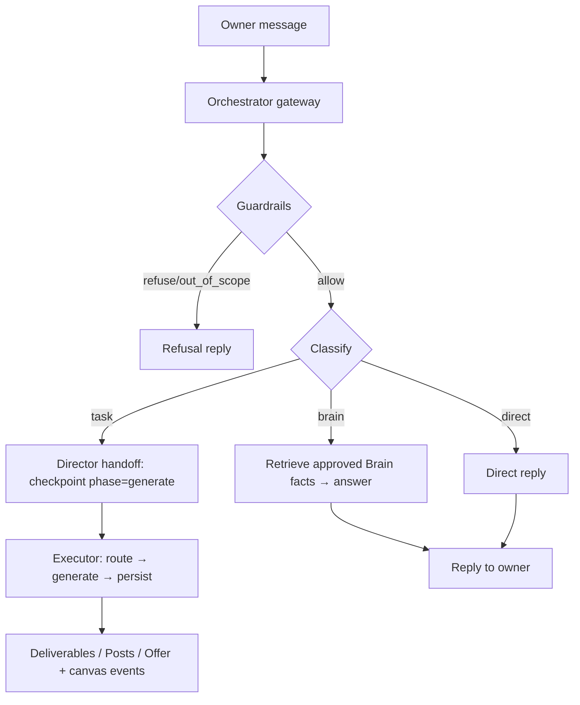
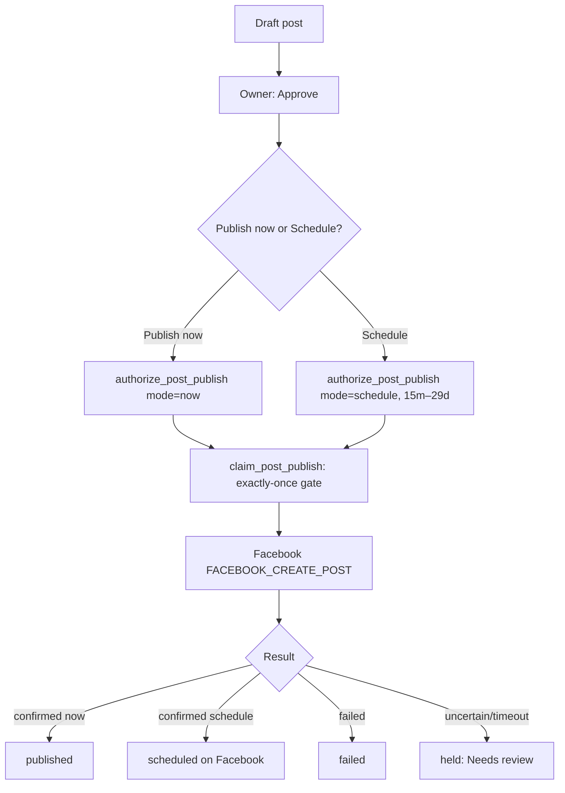
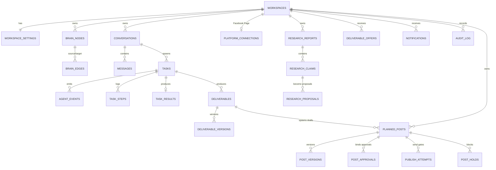
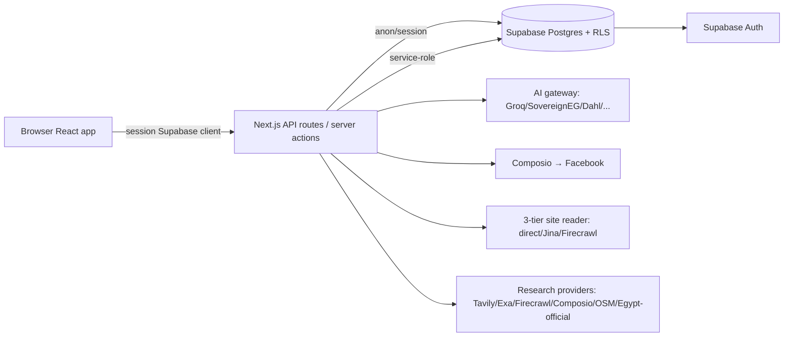

# Busmora — Project Business & Technical Context

> **Purpose of this document.** This is a complete, business-oriented and technically accurate
> knowledge base for an AI assistant that will act as a **Business Analyst, Product Strategist,
> Business-Logic Designer, Technical Consultant, and Feature-Planning Partner** for the Busmora
> product — **without access to the source code**. It explains *what the system does, why, how its
> business processes work, and how its technical components interact*, rather than how individual
> functions are written.
>
> **Confidence labels used throughout:**
> - **[Verified]** — directly supported by the existing implementation (code, schema, tests).
> - **[Inferred]** — strongly suggested by the implementation but not explicitly confirmed.
> - **[Unknown]** — cannot be established from the repository; listed again in Section O.
>
> **Traceability:** important findings cite repository file paths so they can be checked later.

---

## Table of Contents

- [A. Project Overview](#a-project-overview)
- [B. Business Model & Product Structure](#b-business-model--product-structure)
- [C. User Types, Roles & Permissions](#c-user-types-roles--permissions)
- [D. Complete Feature Inventory](#d-complete-feature-inventory)
- [E. Business Logic & Rules](#e-business-logic--rules)
- [F. User Journeys & End-to-End Workflows](#f-user-journeys--end-to-end-workflows)
- [G. Data Model & Business Entities](#g-data-model--business-entities)
- [H. High-Level Technical Architecture](#h-high-level-technical-architecture)
- [I. Integrations & External Dependencies](#i-integrations--external-dependencies)
- [J. Notifications, Events & Automation](#j-notifications-events--automation)
- [K. Business-Critical Dependencies](#k-business-critical-dependencies)
- [L. Current Project State](#l-current-project-state)
- [M. Important Technical & Business Constraints](#m-important-technical--business-constraints)
- [N. Glossary & Project Terminology](#n-glossary--project-terminology)
- [O. Open Questions & Unverified Assumptions](#o-open-questions--unverified-assumptions)

---

## A. Project Overview

### What this product is

**Busmora** is an **AI Marketing Director for small and mid-sized businesses**, built Egyptian-first
(Egypt market, Arabic + English). Instead of a business owner hiring a marketing agency or guessing,
Busmora acts as an always-available marketing director that:

1. **Learns the business** by reading the company's own website and building a structured,
   verified **"Business Brain"** (a knowledge graph of facts about the company).
2. **Answers questions** about the business using that verified knowledge.
3. **Researches the market** (competitors, pricing, audience, positioning) using real, cited public
   sources — never invented data.
4. **Produces marketing deliverables**: social posts, campaign plans, performance diagnoses, and
   research reports.
5. **Publishes** approved social posts to the owner's **Facebook Page**, with a strict human-approval
   gate and exactly-once sending.

The product metaphor is a **"Marketing Director"** who delegates to specialist "agents" and owns the
overall plan, budget, and quality bar — analogous to a human director managing a small team.

> Evidence: `README.md`, `src/server/ai/operations.ts` (system prompt: *"You are Busmora, a marketing
> director for a small business"*), `src/features/research/director/director.ts`.

### What problem it solves

Small Egyptian businesses typically cannot afford a full-time marketing director or agency, and
struggle with: not knowing their real market/competitors, producing consistent content, understanding
why inquiries are falling, and staying "grounded" (not making false claims about prices, results, or
customers). Busmora addresses this by being **evidence-grounded and owner-governed**: it refuses to
invent facts, requires owner approval before knowledge or posts go live, and is honest about unknowns.

### Target users

- **Primary user:** the **owner/founder/marketing lead of a small or mid-sized Egyptian business**
  (single-user account per business). Each account gets one private **workspace**.
- The product is **single-tenant per user**: one account = one workspace = one company. There is no
  multi-user team/role system in the implemented product. **[Verified]**

### Value proposition

- **Grounded, not hallucinated:** every AI claim is tied to evidence; prices/results are never
  fabricated (`src/server/ai/operations.ts`, `src/features/research/policy.ts`).
- **Owner control:** the owner approves knowledge changes and every published post; nothing goes live
  silently.
- **Free to operate:** research runs on free provider tiers with a metered allowance and **no paid
  fallback** — structurally enforced in the database (`free_tier_allowance`, `paid_fallback` cannot be
  stored).
- **Egyptian realism:** pricing (14% VAT, landed price), geography (27 governorates, "Greater Cairo ≠
  all Egypt"), search language (MSA / Egyptian colloquial / Arabizi), and official-source routing are
  built in (`src/features/research/references/*`).

### Main business objectives

- Make the owner's business knowledge reusable across every feature (the Brain is the shared contract).
- Produce trustworthy marketing work product the owner can act on.
- Keep operating cost at/near zero (free-tier only).
- Maintain strict safety: no cross-tenant data access, no forged approvals, no double-publishing.

### Primary use cases

1. **Onboarding:** "Tell Busmora about my business" — via website crawl or a manual form.
2. **Ask the Director:** "What service do we offer?" / "What's our brand voice?" (answered from the Brain).
3. **Research:** "Research my competitors in Cairo," "What do customers complain about?" → cited report.
4. **Content:** "Write 2 posts about our X service," "Plan a 3-post campaign."
5. **Diagnose:** "Why did inquiries fall even though site visits are steady?"
6. **Publish:** approve posts and publish/schedule them to Facebook.

---

## B. Business Model & Product Structure

### How the business operates

Busmora is a **self-serve SaaS product** with a single account type (business owner). The architecture
and code strongly imply a **freemium / tiered SaaS** intended model, but **pricing is explicitly
unannounced / not implemented**:

- A `plan` field exists on workspace settings with values `starter | growth | scale`, defaulting to
  `starter` (`supabase/migrations/20261017171908_busmora_core_schema.sql`). **[Verified — field exists]**
- **No payment processor, subscription billing, checkout, or invoicing exists in the code.** **[Verified — no such modules/routes]**
- `DESIGN.md` states: *"Pricing remains explicitly unannounced; account creation routes to the actual
  signup flow."* **[Verified]**
- A **free-tier usage allowance** system exists and is the de-facto "plan" enforcement today (see
  Section E). There is **no paid fallback** — a structural business decision (`free_tier_allowance`
  table has `CHECK (NOT paid_fallback)`). **[Verified]**

> **Conclusion:** Busmora currently operates as a **free product** with a metered usage allowance. A
> paid tier is *anticipated* (plan field, "Select a plan" UI entry point) but **not built**. Do not
> assume any billing logic exists. **[Verified gap]**

### Main product components (modules)

| Module | What it is | Primary surfaces |
|---|---|---|
| **Onboarding** | Gathers business knowledge (website crawl or manual form), builds the Brain. | `/onboarding` |
| **Business Brain** | The verified company knowledge graph (nodes + edges) the AI reasons over. | `/brain` |
| **Conversations / "Employee"** | Chat with the AI Marketing Director; shows a live "agent canvas." | `/employee` |
| **Orchestrator** | The router that decides how each message is handled (direct / brain / task). | (server-side) |
| **Tasks / Director** | Async execution engine that produces deliverables. | (server-side, surfaced in chat) |
| **Research** | Multi-agent, evidence-first market research → cited bilingual report + PDF. | (runs inside a task) |
| **Roadmap / Discovery** | Guided questionnaire that captures business challenges; drafts a marketing plan. | `/roadmap` |
| **Deliverables** | Library of saved outputs (reports, content, calendars, diagnoses). | `/deliverables` |
| **Scheduling / Publishing** | Approve, schedule, and publish posts to a Facebook Page. | `/scheduling` |
| **Settings** | Account, region/market, AI provider key (BYOK), Facebook connection. | `/settings` |

### How modules relate

The **Business Brain is the hub**. Onboarding populates it; the Orchestrator and Director read only
**approved** Brain facts; Research proposes *new* Brain facts that the owner approves; content and
diagnosis tasks read Brain facts and produce **deliverables**; deliverables can spawn **planned
posts**; posts are approved and published to **Facebook**.

### How users interact

- A **locale-prefixed** web app (`/ar/...`, `/en/...`; default locale is `ar`). **[Verified — `src/lib/i18n.ts`]**
- Protected routes require auth; unfinished onboarding redirects to `/onboarding`.
- Chat is the main interaction; a live **agent canvas** visualizes the orchestrator → director →
  subagents → tools as a graph (`src/components/chat/AgentCanvas.tsx`).

### Customer-facing vs internal-facing

- **Customer-facing:** all `/onboarding`, `/employee`, `/brain`, `/roadmap`, `/deliverables`,
  `/scheduling`, `/settings` screens, plus the public marketing landing page
  (`src/features/marketing/`).
- **Internal / server-only:** the orchestrator gateway, task dispatcher/executor, research director,
  publishing provider, AI key encryption, and all "SECURITY DEFINER" database functions. These are not
  user screens; they enforce the rules. **[Verified]**

---

## C. User Types, Roles & Permissions

### The single user role: Workspace Owner

Busmora implements **one real user type**: the authenticated **workspace owner**. There is **no admin
panel, no staff role, no vendor role, no multi-user teams, no RBAC tier** in the implemented code.
**[Verified — RLS is owner-scoped; no role tables]**

| Attribute | Detail |
|---|---|
| **Who** | The business owner/founder who signs up. |
| **Identity** | A Supabase Auth user; `auth.users.id` **is** the workspace id (1:1). |
| **Responsibilities** | Provide business info, review/approve knowledge, approve & publish posts, configure AI key and social connection. |
| **Can do** | Everything in their own workspace: crawl website, edit/approve/reject Brain items, chat, run tasks, save deliverables, create/approve/publish posts, manage settings and Facebook connection. |
| **Cannot do** | Access any other workspace's data (enforced by Postgres Row-Level Security); bypass approval gates; publish without a connected Facebook Page; exceed the free-tier allowance. |
| **Permissions model** | **Owner-scoped RLS** — every table policy is `workspace_id = auth.uid()`. Mutations go through `SECURITY DEFINER` RPCs that derive the workspace from the session, never trusting a client-supplied workspace id. |

### Authentication states (not roles)

- **Anonymous visitor** → sees marketing page and auth screens only.
- **Authenticated, onboarding incomplete** → forced to `/onboarding`.
- **Authenticated, onboarding complete** → full workspace access.

### Permission boundaries worth knowing (for feature design)

- **AI keys are write-only to the client.** A user can save/remove their own AI provider key, but the
  browser only ever sees a masked hint (last 4 chars), never the key or ciphertext
  (`ai_keys` table; `src/server/key-actions.ts`). **[Verified]**
- **Publishing is Facebook-only and owner-driven.** No role can auto-publish; publishing requires an
  explicit owner click, and `SECURITY DEFINER` send-gates (`claim_post_publish`) are service-role only.
- **Some settings columns are RPC-only.** `onboarding_state`, `plan`, language, and region fields
  cannot be changed by direct client writes — only via RPCs (prevents state forgery). **[Verified]**

> **Implication for new features:** Any "team members / roles / approval chains / multi-approver"
> feature would be a **net-new capability**; the data model has no user↔user relationships beyond the
> single owner per workspace.

---

## D. Complete Feature Inventory

Features are grouped by module. Each entry states purpose, users, behavior, rules, dependencies, and
status.

### D.1 Onboarding

**D.1.1 Website Crawl → Business Brain**
- **Purpose:** Auto-build the Business Brain by reading the company's public website.
- **User:** Owner.
- **How it works:** Owner enters a URL → system crawls a bounded set of same-site commercial pages →
  a reader stack (direct fetch → Jina reader → Firecrawl) retrieves them → JSON-LD/Schema.org and AI
  extraction produce typed facts (the 9 Brain categories) + relationships → facts are saved **as
  approved** Brain nodes with verbatim evidence quotes and source URLs.
- **Business rules:** Single-host only; commercial pages only (skips login/cart/legal/blog/careers);
  hard caps on pages (default 3, 1–5), concurrency (1–3), AI candidates (→ ≤20); same-host evidence
  enforcement; website content treated as untrusted (prompt-injection guarded). **[Verified]**
- **Status:** Fully implemented; covered by E2E (`e2e/specs/02-onboarding-crawl-brain.spec.ts`).

**D.1.2 Manual Business Intake**
- **Purpose:** Alternative to crawl — owner fills a structured business form.
- **How it works:** Form captures name, description, country, service area, 1–20 offerings (with
  pricing model / amount / currency), and a "conversion route" (how customers contact/buy; ready vs
  not_ready). On confirm, the system writes `company_profile` + `offering` Brain nodes as
  `owner_reported`/`approved`, marks onboarding complete, and syncs the workspace name.
- **Business rules:** Required fields validated; offering price must match `^\d+(\.\d{1,2})?$` with a
  3-letter currency; `conversionRoute: ready` requires a type + value; invalid → `INVALID_BUSINESS`. **[Verified]**
- **Status:** Fully implemented; E2E-covered (`e2e/specs/01-auth-database.spec.ts`).

**D.1.3 Onboarding state gating**
- **Purpose:** Force completion before using the workspace.
- **States:** `awaiting_url → crawling → complete` (the `review_pending` state exists in schema/RPC but
  is **not used by the current UI** — vestigial). **[Verified — see Section L]**
- **Status:** Implemented.

### D.2 Business Brain

**D.2.1 Brain knowledge graph (nodes + edges)**
- **Purpose:** The verified company knowledge the AI reasons over.
- **Nodes — 9 categories:** `company_profile, offering, audience, brand_rule, positioning,
  strategic_goal, channel, competitor, company_fact`. **[Verified]**
- **Edges — relations:** `TARGETS, COMPETES_WITH, HAS_TONE, SOLVES_PAIN_POINT, RELATED_TO`. **[Verified]**
- **Lifecycle:** nodes have `status ∈ {candidate, approved, rejected, retired}` plus
  `approval_state ∈ {pending, approved, rejected, legacy}` and
  `verification_state ∈ {unverified, source_supported, contradicted, owner_reported}`.
  **Only approved + current + non-contradicted facts are usable by the AI.** **[Verified]**

**D.2.2 Brain review & approval (list + graph UI)**
- **Purpose:** Let the owner inspect, approve, reject, edit, and bulk-manage knowledge.
- **How it works:** Two views — **list** (tabs All/Approved/Pending; search; category filter; per-card
  Approve/Edit/Reject; bulk Approve-all/Reject-all) and **graph** (React-Flow mind-map: hub → category
  pills → knowledge cards, cross-links, status/category filters, inspector). **[Verified]**
- **Rules:** `update_brain_item` validates categories, title/summary bounds, offering price format,
  optimistic `version`, stamps `user_edited`, writes a `brain_versions` snapshot + audit, and triggers
  a context-change cascade. Deleting a node cascades to edges and holds dependent posts. **[Verified]**

**D.2.3 Brain proposals (crawler/AI-suggested *changes*)**
- **Purpose:** When a re-crawl proposes a *change* to an existing fact, the owner reviews it (approve /
  edit-and-approve / reject) rather than silently overwriting. **[Verified]**
- **Note:** First-crawl facts are auto-approved; proposals mainly cover **changes** and **research**
  findings. (See E for the auto-approval evolution.)

**D.2.4 Research proposal review**
- **Purpose:** Research-derived facts arrive as **pending proposals** (never auto-write to the Brain);
  owner approves/rejects (with bulk approve). Approval is the **only** path that creates a
  `research`-sourced Brain node. **[Verified — `decide_research_proposal`]**

### D.3 Conversations / AI Marketing Director ("Employee")

**D.3.1 Chat with the Director**
- **Purpose:** Conversational interface to the AI marketing director.
- **How it works:** Every message → **Orchestrator** → one of: **direct** answer, **brain** answer
  (from approved facts), or **task** (delegated to the Director/executor). **[Verified]**
- **Features:** conversation list/history, per-conversation canvas layout persistence (local browser),
  markdown rendering, post-reference cards, deliverable-offer cards, Facebook post previews. **[Verified]**

**D.3.2 Live agent canvas**
- **Purpose:** Visualize *how* the AI is working (transparency).
- **How it works:** A React-Flow graph reconstructed from persisted `agent_events`:
  user → orchestrator → director → subagents → tools/skills, with live states
  (queued/running/completed/failed/partial), source/credit counts, and a per-node inspector. **[Verified]**

**D.3.3 Chat auto-titling**
- **Purpose:** Give each conversation a short title from the first user message (≤60 chars).
- **Rules:** Only retitles while it's still the first user message. **[Verified — `src/server/chat-title.ts`]**

### D.4 Orchestrator (routing)

**D.4.1 Intent routing**
- **Purpose:** Decide how each message is handled, cheaply and safely.
- **Paths:** `direct | brain | task` (+ `refuse` / `error`). **[Verified]**
- **Order:** idempotent replay → guardrails (refuse/out-of-scope) → instant greeting (zero model calls)
  → one classification model call → dispatch. **[Verified — `src/features/orchestrator/gateway.ts`]**
- **Rules:** quantity clamped 1–12; never fabricate; treat retrieved data as data, not instructions.

**D.4.2 Guardrails (safety boundary)**
- **Purpose:** Deterministic, pre-model refusal of unsafe/off-topic requests.
- **Refuses:** system-prompt/instruction probes, override/jailbreak attempts, secret/credential probes
  (`refuse`); politics/sports/weather/other off-topic domains (`out_of_scope`). Bilingual (EN/AR).
  **[Verified — `src/features/orchestrator/guardrails.ts`]**

### D.5 Tasks / Director (execution engine)

**D.5.1 Task lifecycle & state machine**
- **Purpose:** Run heavier work asynchronously and resumably.
- **Statuses:** `queued → running → awaiting_input → (awaiting_approval) → completed | failed |
  cancelled | interrupted | partial`. The real state machine is the checkpoint phase:
  `route → generate → persist → done`. **[Verified]**
- **Mechanics:** persisted leases, heartbeats, checkpoints, max 5 attempts, max 2 concurrent running
  tasks per workspace (research runs **alone** because it shares one allowance). **[Verified]**

**D.5.2 Content creation (posts)**
- **Purpose:** Generate grounded social posts (captions + hashtags + visual brief + suggested time).
- **Rules:** Exactly the requested quantity (1–12; campaign default ≥3); caption ≤6000 chars, hashtags
  ≤1000; proposed times 1h–60d out, 09:00–21:00 workspace-local, ≥1 day apart unless specified;
  **suggestions only, never a schedule**; no fabricated prices. Partial results are kept and flagged;
  zero valid drafts = hard failure. **[Verified]**

**D.5.3 Campaign planning**
- **Purpose:** Multi-post campaign with a markdown planning brief + a post set.
- **Rules:** Produces a brief + 3–12 posts (or the requested number); posts become drafts; brief saved
  as a deliverable. **[Verified]**

**D.5.4 Performance diagnosis**
- **Purpose:** Diagnose marketing problems (e.g., falling inquiries) with observations vs hypotheses,
  constraints, alternatives, and recommended actions — explicitly *not* "always post more/spend more."
  **[Verified]**

**D.5.5 Task clarification (awaiting_input)**
- **Purpose:** When indispensable info is missing, the task pauses and asks the owner one structured
  question (with options + Other/Unknown); the answer resumes the task. **[Verified]**

**D.5.6 Task recovery / resume**
- **Purpose:** Recover tasks orphaned by crashes/timeouts and allow retry after failure.
- **Rules:** `recover_tasks` reaps expired leases (>120s) → `interrupted`; `resume_task` requeues
  failed/interrupted (not publishing), max 5 attempts. **[Verified]**

### D.6 Research (market intelligence)

**D.6.1 Five specialist research agents (a dependency chain)**
1. **Market Scout** (`market_demand`) — market frame: competitor count, governorates, categories,
   demand seasonality, Egyptian query lexicon; classifies competitors.
2. **Competitor Intelligence** (`competitor_commercial`) — competitor profiles + **landed-price**
   comparison (VAT 14% + delivery + unit normalization), not shelf prices.
3. **Audience Intelligence** (`customer_audience`) — bounded public social sample (FB/IG/TikTok via
   Composio), preserving original quotes, with an explicit "who is missing" frame.
4. **Brand Positioning** (`brand_positioning`) — positioning hypotheses from audience language;
   "white space" declared only under 4 conditions.
5. **Benchmark & Strategy** (`benchmark_strategy`) — weighted competitor benchmark + opportunity-gap
   scoring + recommendations as **bounded experiments**.
   **[Verified — `src/features/research/agents/*`]**

**D.6.2 Research Director**
- **Purpose:** Plans tracks, allocates one shared budget, runs specialists concurrently by dependency
  layer (≤3 concurrent), shares an entity registry + content cache, and can **reduce scope** (drop a
  layer) when the allowance is low — never buys credits. **[Verified]**

**D.6.3 Research report (bilingual, cited) + PDF**
- **Purpose:** Produce a structured, cited report with a claim ledger, unknowns/limitations sections,
  and audit (citation coverage, claim quality).
- **PDF:** headless-Chromium print-to-PDF with **automated QA gates** (openability, page count, Arabic
  glyph coverage ≥80%, clickable citations, visual QA). Completion is gated on passing. **[Verified]**

**D.6.4 Free-tier allowance / metering**
- **Purpose:** Keep research free and bounded. Per-mode budgets (quick/standard/deep); one shared
  ledger (reserve → execute → settle); **rolling 24-hour window**; paid fallback structurally
  impossible. **[Verified]**

### D.7 Roadmap / Discovery

**D.7.1 Guided discovery questionnaire**
- **Purpose:** Capture the owner's real business challenge in plain language (8 goals: validate_idea,
  win_first_customers, grow_customers, convert_inquiries, unprofitable_marketing, launch_offer,
  increase_repeat_referral, something_else).
- **How it works:** A **deterministic** question planner (no AI) asks a baseline set + goal-specific
  branch + a success signal; pre-fills from **approved** Brain facts where eligible; missing info
  becomes an explicit question or "unknown." Answers saved with optimistic concurrency. **[Verified]**

**D.7.2 Preliminary plan**
- **Purpose:** Save a "preliminary plan state" capturing open unknowns for the next step.
- **Current behavior (important):** The wizard saves a *preliminary plan state* and explicitly does
  **not** generate or activate a Roadmap yet ("No Roadmap was generated or activated; open unknowns
  are recorded for the next step."). The `roadmaps` / `roadmap_steps` tables and a `roadmap` AI
  operation exist, but **no code currently writes a roadmap** or calls the roadmap model operation.
  **[Verified — see Section L]**

### D.8 Deliverables

**D.8.1 Deliverable library**
- **Purpose:** Store, search, view, version, edit, delete saved outputs.
- **Types:** `research_report, competitor_analysis, content_posts, content_calendar,
  performance_diagnosis, general`. **[Verified]**
- **Rules:** Cursor-paged, server-filtered listing (limit 1–50); edits are copy-on-write with immutable
  `deliverable_versions`; version/CAS checks. **[Verified]**

**D.8.2 Deliverable offers (save/dismiss)**
- **Purpose:** Instead of auto-saving substantial task results, the system *offers* to save them;
  owner Saves or Dismisses. **[Verified — `deliverable_offers`, `accept/dismiss_deliverable_offer`]**

### D.9 Scheduling & Publishing

**D.9.1 Post approval & two-step publish**
- **Purpose:** Owner approves post text, then explicitly publishes/schedules to Facebook.
- **Rules:** Two-step owner action; **exactly-once** send per version; sent posts are **locked**
  (no edit/delete); publishing is **Facebook-only**. **[Verified]**

**D.9.2 Facebook Page connection (OAuth via Composio)**
- **Purpose:** Connect the owner's Facebook Page so posts can be published.
- **How it works:** Composio-managed OAuth "Connect Link"; nonce-protected callback; page chooser if
  the account manages multiple pages; one Page per workspace. **[Verified]**

**D.9.3 Calendar / scheduling UI**
- **Purpose:** Visualize and manage posts (month/week/unscheduled/day-plan), with Facebook-style
  previews and contextual actions (Approve/Reject/Edit/Schedule/Publish now/Publish yourself/Retry).
- **Rules:** Times interpreted in **workspace timezone**, never the browser's. **[Verified]**

**D.9.4 Post recovery**
- **Purpose:** If a workspace has zero posts, reconstruct **drafts** from recent deliverable cards
  (deterministic idempotency key); never sends anything. **[Verified]**

### D.10 Settings

**D.10.1 Account & region preferences**
- Region/market: country, currency (ISO 3-letter), target market, timezone (with live preview);
  optimistic-version save. UI/conversation language are locked to **English** at the DB level
  (region stays free). **[Verified]**

**D.10.2 AI provider key (BYOK)**
- **Purpose:** Let the owner supply their own AI provider key (one per workspace), AES-256-GCM
  encrypted server-side; browser sees only a masked hint. Providers: openai/groq/anthropic/google/
  openrouter/dahl/sovereigneg/custom. Custom base URLs must be in a server allowlist. If absent, a
  **managed model** (server env) is used. **[Verified]**

**D.10.3 Facebook connection card**
- Connect/disconnect, page chooser, status badges, result banners. **[Verified]**

---

## E. Business Logic & Rules

This section captures the *business meaning* of the enforced rules. Unless noted, all are **[Verified]**
in migrations and/or server modules.

### E.1 Knowledge governance (the Brain)

- **Only approved + current + non-contradicted facts are usable by the AI.** Candidates, rejected, and
  retired nodes are excluded from orchestrator answers, task context, and discovery prefill.
- **Confidence never grants approval.** A crawler/AI confidence score does not equal owner approval.
  (Historically crawl facts required approval; the current `save_crawl_brain` **auto-approves**
  source-backed website facts, while *changes* and *research* still require owner approval.)
- **Owner edits are sacred.** Re-crawls are additive: they never overwrite `user_edited` facts, manual
  edges, or rejected/retired nodes.
- **Context-change cascade.** Editing/deleting a Brain node marks dependent deliverables **stale** and
  places dependent scheduled posts **on hold** (a `context_hold` notification), requiring owner review.
- **Epistemic honesty.** Facts carry `epistemic_kind ∈ {fact, claim, inference, unknown}` and
  `verification_state`; unknowns are preserved, not coerced to zero.

### E.2 Business intake validation

- Required: name (1–150), description (1–3000), country (1–100), serviceArea (1–300), 1–20 offerings,
  conversion route ready/not_ready.
- Offering price must match `^[0-9]+(\.[0-9]{1,2})?$` and currency `^[A-Z]{3}$`.
- On confirm: writes `company_profile` + one `offering` per offering (source=manual, approved,
  owner_reported), sets `onboarding_state='complete'`, records `confirmed_intake_version`, syncs
  workspace name, writes audit. Invalid → `INVALID_BUSINESS`.

### E.3 Onboarding state machine

`awaiting_url → crawling → complete`. State is server-owned (clients cannot UPDATE it directly). The
workspace is usable only when `complete`. `review_pending` exists but is unused by the UI.

### E.4 Orchestrator decision rules

- **One model call** classifies intent into direct/brain/task. Guardrails and instant greetings run
  **before** any model call.
- **Brain path is read-only** and scored (category boost, token/stem match, verification preference);
  if the Brain is unavailable, it returns an honest "Brain unavailable" refusal rather than fabricating.
- **Task handoff** pre-seeds a checkpoint at phase `generate`, so the executor does **not** re-route.
- Quantity clamped 1–12; replies ≤12000 chars; brain query ≤1000 chars.

### E.5 Task budgets & limits

- Per-task `allowance = {calls, pages, tokens, seconds}` + `consumption`; AI calls **reserve** then
  **settle** tokens. Exhaustion → `BUDGET_EXHAUSTED` (non-retryable).
- Per-operation token caps (e.g., route 800, campaign 6000, else 3500).
- Max 2 concurrent running tasks per workspace; research runs alone (shared allowance).
- Max 5 attempts per task; expired lease reaped at >120s.

### E.6 Content generation rules

- **Exactly the requested quantity** (1–12). Campaign default ≥3.
- Caption 1–6000 chars; hashtags ≤1000; ≤12 posts per result.
- **Proposed times are suggestions only** (1h–60d out, 09:00–21:00 workspace-local, ≥1 day apart unless
  the user specifies; explicit dates honored). The AI never schedules.
- No fabricated prices, discounts, stats, testimonials, or deadlines. Partial results flagged `partial`.

### E.7 Research rules (free-tier + epistemic)

- **Free-tier only.** Rolling 24h allowance (calls/pages/tokens/credits); **paid fallback impossible to
  store** (`CHECK (NOT paid_fallback)`) and rejected at runtime (`POLICY_VIOLATION`).
- **Track weighting** splits the run budget (market 0.30, competitor 0.30, audience 0.20, positioning
  0.10, benchmark 0.10).
- **Owner approval required** for research facts to enter the Brain; research writes **pending
  proposals**, never nodes directly.
- **Epistemic rules:** missing ≠ zero; absence of evidence ≠ evidence of absence; discovery (search hit)
  ≠ evidence (a page must be opened & extracted).
- **Geography integrity:** "Greater Cairo is never all Egypt" — nationwide claims need nationwide
  evidence. **Pricing integrity:** 14% VAT applied once, landed-price comparison, `comparable()` gate.
- **Composio social caps** bound the public sample (profiles/posts/videos/comments/transcripts).

### E.8 Publishing rules

- **Two-step owner approval:** (1) approve text → `approved`; (2) Publish now / Schedule →
  `authorize_post_publish` binds the exact version + Page + time, then the server sends **once**.
- **Exactly-once send:** `publish_attempts UNIQUE(post_version_id)`; a second attempt yields
  `ALREADY_ATTEMPTED`. Never auto-retried.
- **No scheduler in Busmora:** "schedule" uses **Facebook native scheduling** (send now with a future
  `scheduled_publish_time`). Busmora itself runs no cron/scheduler. **[Verified — migration comments;
  no cron route in code]**
- **Schedule window:** 15 min–29 days ahead (server/UI); Facebook 10 min–30 days; lateness allowance = 0.
- **Sent posts are locked:** no edit/delete; `delete_post` raises `HAS_PUBLISH_HISTORY`.
- **Authorization generation:** changing the Page/provider account bumps it, **invalidating prior
  approvals**; disconnect **holds** scheduled posts (time → `proposed_for`) and requires re-scheduling.
- **Uncertain outcomes** → `execution_state='uncertain'` + a hold ("Needs review"); a stale `claimed`
  attempt (no result within 10 min) becomes "Needs review." Never auto-published.
- **Production refuses the fake provider** (`PUBLISHING_PROVIDER=fake` + production → disabled).

### E.9 State machines (summary)

- **Post (`planned_posts`):** `status` draft → approved → publishing → published/failed (plus
  scheduled, rejected); orthogonal `approval_state` (unapproved/approved/rejected) and `execution_state`
  (idle/scheduled/submitted/confirmed/failed/uncertain/held/cancelled/owner_reported).
- **Task:** queued → running → (awaiting_input) → completed/failed/cancelled/interrupted/partial.
- **Brain node:** candidate → approved → (retired/rejected); `approval_state` pending/approved/rejected/legacy.
- **Discovery question:** unanswered/answered/unknown/skipped/not_applicable/researching/confirmed.
- **Deliverable offer:** offered → saved / dismissed.
- **Connection:** connected / expired / disconnected.

---

## F. User Journeys & End-to-End Workflows

### F.1 Onboarding (website path)

1. Owner signs up → `bootstrap_workspace` creates workspace + settings (`awaiting_url`).
2. Owner lands on `/onboarding`, chooses **Website**, enters a URL.
3. Client validates URL; `set_onboarding_state('crawling', url)`.
4. `POST /api/crawl` `read` → server crawls pages (3-tier reader), extracts facts (JSON-LD + AI),
   streams progress; candidates returned for draft prefill.
5. `POST /api/crawl` `organize` → `save_crawl_brain` persists **approved** nodes + edges + sources,
   updates crawl_status, syncs workspace name, writes audit.
6. `set_onboarding_state('complete')` → summary screen → "Contact the Director" (`/employee`) or
   "Select a Plan" (`/settings`).
- **Failure:** reverts to `awaiting_url`, preserves draft fields.
- **Side effects:** Brain populated; `website_proposals_saved` audit; notifications deduped.

```mermaid
flowchart TD
  A[Sign up] --> B[bootstrap_workspace: awaiting_url]
  B --> C{Choose method}
  C -->|Website| D[Validate URL → crawling]
  D --> E[/api/crawl read: 3-tier reader + AI extract/]
  E --> F[/api/crawl organize: save_crawl_brain/]
  F --> G[Auto-approved Brain nodes + edges + sources]
  G --> H[onboarding_state = complete]
  C -->|Manual| I[Fill business form]
  I --> J[confirm_business_draft → Brain + complete]
  H --> K[/employee]
  J --> K
```

### F.2 Asking the Director (chat message → answer/task)

1. Owner sends a message in `/employee`.
2. Client `POST /api/tasks` `orchestrate` (idempotency key).
3. **Orchestrator gateway**: idempotent replay check → guardrails → greeting? → one classify call.
4a. **direct** → return reply.
4b. **brain** → scored retrieval over approved facts → answer; if Brain down, honest refusal.
4c. **task** → `planDirectorHandoff` → enqueue + admit + run `executeTask` (route→generate→persist).
5. Executor persists deliverable(s)/posts (or a deliverable **offer**), messages, canvas events.
6. Background `dispatchTasks` (via `after()`) drains any queued tasks.
- **Failure:** honest error message; task marked failed/interrupted (resumable).



### F.3 Research (market intelligence)

1. Owner asks a research question → orchestrator forces a `marketing_research` task.
2. `runMarketingResearch`: build brief → Research Director plans tracks & budget → specialists run
   concurrently by dependency layer over metered providers (reserve/settle against the 24h allowance).
3. Synthesis → bilingual cited report (markdown) → PDF with QA gates.
4. `save_research_result` persists report, sources, claims, context deps, messages, task result.
5. Claims → `analyzeClaims` → **pending** `research_proposals` (+ `task_complete` notification).
6. Owner reviews proposals in Brain UI → `decide_research_proposal` (approve) creates `research` Brain
   nodes.
- **Failure/limits:** low allowance → scope reduced (tracks dropped); blocked sources stored with reason;
  run marked `partial` if tracks skipped/failed.

### F.4 Content / Campaign / Diagnosis

1. Orchestrator routes to task → executor `generate` calls the appropriate model operation
   (`copy` / `campaign` / `diagnose`) with approved Brain facts in context.
2. Posts validated (caption/hashtags/time caps); drafts created; brief/document built.
3. `save_task_result` persists deliverable + posts + context deps; a **deliverable offer** may be
   created instead of auto-saving.
4. Owner reviews in chat (post-reference cards) and/or Deliverables; posts appear in Calendar as drafts.

### F.5 Publishing a post (two-step, owner-driven)

1. Owner opens `/scheduling`; posts shown as drafts (or "Proposed" if only `proposed_for`).
2. **Step 1:** Owner clicks **Approve** → `update_post 'approved'` (creates immutable version).
3. **Step 2:** Owner clicks **Publish now** or **Schedule** → `authorize_post_publish` (binds exact
   version + Page + time; schedule must be 15 min–29 days ahead).
4. Server `publishPost`: `claim_post_publish` (single send gate) → provider `FACEBOOK_CREATE_POST`
   (`published: true` now, or future `scheduled_publish_time`) → `record_publish_result`.
5. Outcomes: confirmed→published/scheduled; failed→failed (auth_expired marks connection expired);
   uncertain→hold + "Needs review."
- **Failure:** never auto-retried; owner uses Retry (new version) or "Reviewed keep text."



### F.6 Facebook Page connection

1. Owner clicks Connect in Settings → `start` (nonce cookie) → redirect to Facebook consent.
2. Callback verifies nonce + account ownership/ACTIVE → if 1 page auto-save; if many → page chooser.
3. `select` re-verifies and `upsert_facebook_connection` (bumps authorization_generation).
4. Disconnect → deletes Composio account + `disconnect_facebook_connection` (holds scheduled posts).

---

## G. Data Model & Business Entities

### Conceptual ER overview



### Key entities (business meaning)

| Entity | Represents | Notable fields / lifecycle |
|---|---|---|
| **workspaces** | The tenant root; one per account (`id = auth.users.id`). | `name` (synced from company_profile). |
| **workspace_settings** | Onboarding/setup state + region + plan. | `onboarding_state`, `company_url`, `country/currency/timezone`, `brand_colors`, `plan`, `crawl_status`. |
| **brain_nodes** | One verified company fact in 9 categories. | `category`, `status`, `approval_state`, `verification_state`, `epistemic_kind`, `confidence`, `source`, `version`, `provenance`, `is_current`. |
| **brain_edges** | Semantic relationship between nodes. | `relation_type`, `status`, `weight`, `provenance`. |
| **brain_versions** | Immutable snapshots of node history. | written on each edit (service-role). |
| **brain_proposals** | A proposed *change* to a node, pending owner decision. | `diff`, `base_version`, `status`, fingerprint dedupe. |
| **sources** / **claim_sources** | Retrieved evidence + which source supports a claim. | `url`, `excerpt`, `content_hash`, `availability`, `provider`. |
| **context_dependencies** | Which task/doc/post/roadmap consumed which node version (drives staleness/holds). | polymorphic consumer. |
| **conversations** / **messages** | Chat threads + messages (many structured types). | `messages.type` includes text/form/task_status/deliverable_card/deliverable_offer/post_reference/knowledge_notification/error. |
| **tasks** | An execution unit. | `type`, `status`, `origin` (direct/wizard_question/roadmap_step/document), `research_mode`, `attempts`, `allowance`, `consumption`, `checkpoint`. |
| **task_steps / agent_events / task_results** | Per-run step log, canvas replay stream, final result. | `agent_events.seq` monotonic; conversation-scoped + task events. |
| **deliverables / deliverable_versions** | Saved outputs + immutable versions. | `type`, `stale_reason`, `context_refs`, `source_refs`, `limitations`. |
| **deliverable_offers** | An offer to save a substantial result. | `state` offered/saved/dismissed. |
| **planned_posts** | A social post. | `status`, `approval_state`, `execution_state`, `scheduled_for`, `proposed_for`, `current_version_id`, `idempotency_key`. |
| **post_versions / post_approvals / publish_attempts / post_holds** | Immutable content revisions, bound approvals, the single send-gate record, and blocks. | `publish_attempts UNIQUE(post_version_id)`; `post_holds.kind`. |
| **platform_connections** | The connected Facebook Page (one per workspace). | `status`, `authorization_generation` (in connection_credentials). |
| **connection_credentials / oauth_transactions** | Encrypted page tokens + OAuth handshake state (service-role). | never client-readable. |
| **research_reports / research_claims / research_proposals** | Cited report, claim ledger, and typed proposals. | `mode`, `citation_coverage`, `claim_quality`, `confidence` (hypothesis→strong). |
| **free_tier_allowance / provider_usage** | The metered free-tier budget + per-call ledger. | rolling 24h window; `paid_fallback` cannot be true. |
| **notifications** | In-app notifications (deduped). | `type`, `dedupe_key` unique. |
| **audit_log** | Append-only record of knowledge & approval actions. | insert/select only. |
| **ai_keys / app_secrets** | Encrypted BYOK AI key + server secret root. | browser never sees ciphertext. |

### Important relationships

- **One-to-one:** workspace ↔ workspace_settings; workspace ↔ platform_connections (Facebook); task ↔
  task_results.
- **One-to-many:** workspace → brain_nodes/edges, conversations, tasks, deliverables, posts, etc.
- **Graph (many-to-many via edges):** brain_nodes ↔ brain_edges ↔ brain_nodes.
- **Polymorphic consumers:** context_dependencies link tasks/documents/posts/roadmaps to brain versions.

### Data lifecycle rules

- **Immutable versions** for deliverables, posts, brain nodes (history preserved; copy-on-write edits).
- **Soft governance:** rejected/retired nodes are kept, never hard-erased (except account deletion
  cascade).
- **Auto-approval of crawl facts** (source-backed) vs **owner approval for research/changes/manual**.
- **Staleness propagation:** editing a node can stale deliverables and hold posts.

---

## H. High-Level Technical Architecture

### Stack

- **Frontend:** Next.js 16 (App Router) + React 19 + TypeScript; Tailwind CSS; React Flow for graphs;
  `lucide-react` icons. **[Verified — `package.json`]**
- **Backend:** Next.js server **API routes** (`src/app/api/*`) + server modules (`src/server/*`).
  **No Supabase Edge Functions** are used for core logic (a legacy OAuth edge-style route exists but the
  current path is server routes). **[Verified — `README.md`]**
- **Database/Auth/Storage:** **Supabase** (Postgres + RLS + Auth + Storage).
- **AI:** Multi-provider gateway (`src/server/ai-generate.ts`) over Groq / SovereignEG / Dahl / OpenAI /
  Anthropic / Google / OpenRouter / custom, with a 4-tier fallback template.
- **Publishing:** **Composio** (`@composio/core`) as managed OAuth broker + Facebook tool executor.

### Layers

1. **Presentation:** locale-prefixed app (`/[lang]/...`), workspace screens, marketing site.
2. **API / server actions:** Next.js route handlers + server actions enforce auth, same-origin, size
   limits, and call into server modules.
3. **Domain / orchestration:** orchestrator gateway, task dispatcher/executor, research director,
   publishing core — pure-ish modules with injected dependencies (testable).
4. **Data:** Postgres via Supabase; **all mutations go through SECURITY DEFINER RPCs**; RLS on every
   table. Two Supabase clients: **anon/session** (user) and **admin/service-role** (server-only).

### Request/data flow

- Browser uses the **session-scoped** Supabase client for reads and RPC calls; sensitive sends use
  server modules with the **service-role** client.
- `requireApiIdentity` enforces auth + **same-origin** on mutating requests (CSRF protection).
- Background work runs via Next.js `after()` (`dispatchTasks`) — **not** a durable queue; leases +
  checkpoints in Postgres make interrupted work recoverable.

### AuthN/AuthZ

- Supabase Auth (email/password; PKCE OAuth callback). Workspace = `auth.users.id`.
- **RLS** owner-scoped everywhere; **column-level grants** for least privilege (e.g., ai_keys
  ciphertext never granted to clients); **SECURITY DEFINER** functions derive workspace from the session.

### File storage

- Supabase Storage bucket **`owner-media`** (private, ≤10MB, image MIME only), objects keyed by
  `auth.uid()` as first folder; immutable (replacements use new paths). **[Verified]**

### Background processing & caching

- **No durable job queue / scheduler.** Task draining via `after()`; recovery via `recover_tasks`.
- **In-memory caches:** crawl retry cache (per user+URL, 5 min), page cache (60 pages, 5 min), Brain
  read caches; conversation canvas layout persisted in browser local storage.

### Deployment (discoverable)

- Node ≥20.9; `next build` / `next start`; E2E via Playwright against a disposable Supabase project.
- `.env.example` references a `CRON_SECRET` for `/api/cron/publish-due`, but **no such route exists in
  the repo** (see Section L). **[Verified gap]**



---

## I. Integrations & External Dependencies

| Integration | Why / business function | Info exchanged | Workflows depending on it | If unavailable |
|---|---|---|---|---|
| **Supabase (Auth/Postgres/Storage/RLS)** | Core identity, data, files. | User creds, all business data, media. | Everything. | Product unusable. |
| **Groq** | Primary fast model (orchestrator, chat, router, crawl extraction). | Prompts/responses. | Orchestrator, chat, onboarding crawl. | Fallback to SovereignEG/Dahl/others. |
| **SovereignEG** | Sovereign AI provider (content, campaign, research subagents, diagnosis, fallback). | Prompts/responses. | Content/campaign/research. | Fallback chain. |
| **Dahl** | Roadmap + research director/synthesis models; crawl fallback. | Prompts/responses. | Research, roadmap. | Fallback chain. |
| **OpenAI / Anthropic / Google / OpenRouter / custom** | Optional BYOK providers. | Prompts/responses (owner's key). | Any task if owner configured. | Managed model used. |
| **Firecrawl** | Page extraction / anti-bot bypass for crawl + research. | Page HTML → markdown. | Onboarding crawl, research. | Falls back to Jina/direct (crawl); sources marked blocked (research). |
| **Jina Reader** (`r.jina.ai`) | Reader fallback for crawling. | URL → text. | Onboarding crawl. | Falls back to Firecrawl/direct. |
| **Tavily** | Keyword search (candidate URLs) for research. | Query → URLs. | Research (market/competitor). | Escalates to Exa; coverage gap noted. |
| **Exa** | Semantic search (long-tail discovery). | Query → URLs. | Research. | Escalates to Tavily; coverage gap. |
| **Composio** | Managed OAuth + Facebook publishing + bounded social sample. | OAuth tokens; FB page list; create-post; social sample. | Facebook connect, publishing, audience research. | Publishing "not configured"; audience track limited. |
| **OpenStreetMap / Overpass** | Local presence / geographic coverage (free maps). | Query → POIs. | Research (local coverage). | Coverage gap noted. |
| **Egypt official sources** (CAPMAS, MCIT, NTRA, CBE, GAFI, etc.) | High-authority official data. | Direct reads. | Research (authoritative claims). | Lower authority fallback; lag noted. |
| **Facebook Graph API (via Composio)** | Create posts, schedule, read pages. | Page id, message, publish time. | Publishing. | `failed`/`uncertain`; never auto-retried. |

**Resilience patterns:** multi-provider AI fallback; reader fallback chain; research provider escalation
with recorded reasoning; publishing outcomes are explicit (confirmed/failed/uncertain) and never silently
retried; crawl uses a compatibility add-only path if the atomic RPC is missing.

---

## J. Notifications, Events & Automation

### Notifications (in-app, `notifications` table, deduped)

| Type | Title | Trigger | Recipient |
|---|---|---|---|
| `brain_proposal` | "Website suggestion ready" | A new brain *change* proposal is created (not for unchanged facts). | Owner |
| `context_hold` | "Review changed business context" | A Brain node changed and a scheduled post depends on it (post held). | Owner |
| `task_complete` | "Research report ready" / "Partial research result ready" | A marketing-research task completes. | Owner |

- UI: a bell in `AppShell` (`NotificationCenter`) showing latest 50, unread badge, "Mark all read."
- **Separately:** `knowledge_notification` is a **chat message** type (not a notifications row).

### Events / canvas

- `agent_events` (agent_started/completed/error, tool_call, delegation, skill_read, flow_connection)
  drive the live agent canvas. Orchestrator and tasks both emit events; the conversation event stream is
  unified for replay.

### Automation (what happens automatically)

- **Onboarding crawl** runs automatically when the owner submits a URL (read + organize).
- **Chat auto-titling** on first message.
- **Task draining** via `after()` after an API request (`dispatchTasks`).
- **Task recovery** (`recover_tasks`) on `refresh` and page interactions.
- **Stale publish-claim sweep** (`mark_stale_publish_attempts`) on calendar load → "Needs review."
- **Post recovery** (`recoverPosts`) reconstructs drafts when a workspace has none.
- **No scheduled/cron automation** is implemented (no background publisher; scheduling is Facebook-native).

---

## K. Business-Critical Dependencies

Use this to reason about the blast radius of a new feature.

- **Brain is the shared contract.** Onboarding, orchestrator brain path, task context, discovery prefill,
  and research proposals all depend on **approved** Brain facts. Changing Brain categories/status rules
  affects every AI feature.
- **Auth + RLS underpin everything.** Any feature touching data must respect owner-scoping and go through
  RPCs; bypassing this breaks tenant isolation.
- **Onboarding completeness gates the app.** `onboarding_state != complete` blocks workspace access.
- **Context dependencies couple Brain edits to posts/deliverables.** Editing a node can stale
  deliverables and hold posts — a cross-module side effect to preserve.
- **Approval integrity couples posts to versions.** Approvals bind to exact `post_version_id`; editing
  content revokes approval; sending locks the post.
- **Authorization generation couples connections to approvals.** Reconnecting/adding a Page invalidates
  prior approvals and holds scheduled posts.
- **Shared allowance couples all research.** Research runs alone; one workspace's allowance is shared
  across all research tasks.
- **Originating entities couple tasks to their source.** `task.origin` (direct / wizard_question /
  roadmap_step / document) links a task to the workflow that created it; DB triggers validate ownership.
- **Order-sensitive operations:** approve-then-publish (two steps); plan-then-activate (roadmap, not yet
  built); crawl-then-organize (read then save).
- **AI provider config couples tasks to key availability.** Missing/invalid keys degrade to managed model
  or fail with typed errors.

---

## L. Current Project State

### Fully implemented (E2E-verified where noted)

- Auth + workspace bootstrap + onboarding gating (`01-auth-database.spec.ts`).
- Business intake confirmation (atomic, versioned, audited) (`01`).
- Website crawl → auto-approved Brain (`02`).
- Orchestrator direct/brain routing; content/campaign/diagnosis tasks; research report with cited
  sources (`03`).
- Deliverables save/version/search; post scheduling; publishing attempt recording (`04`).
- Idempotency, same-origin/CSRF rejection, cross-tenant rejection, account-deletion cascade (`05`).
- Brain governance, proposals, graph/list UI.
- Facebook connection (Composio), two-step publish, calendar UI.
- Free-tier allowance + research pipeline + PDF QA.

### Partially implemented / incomplete

- **Roadmap generation is incomplete.** The Discovery wizard collects answers and saves a **preliminary
  plan state**, but **does not generate or activate a Roadmap**. The `roadmaps` / `roadmap_versions` /
  `roadmap_steps` / `step_actions` tables and a `roadmap` AI operation + validation exist, but **no code
  writes a roadmap or calls the roadmap operation.** The wizard explicitly says so. **[Verified]**
- **No background publisher / cron.** Publishing is owner-click-driven; Facebook handles scheduling.
  `.env.example` references `/api/cron/publish-due` and `CRON_SECRET`, and `e2e/specs/04` describes "the
  background publisher claims a due approved Post," but **no `/api/cron/publish-due` route exists in the
  repo**, and nothing calls `claim_post_publish` outside the owner-driven `publishPost` path. This is a
  **discrepancy / likely gap** (see Section O). **[Verified gap]**
- **Instagram** is declared as a data concept (`Platform = 'facebook' | 'instagram'`) and a legacy
  self-hosted OAuth flow can handle it, but the **actual publishing provider is Facebook-only**; there is
  **no working Instagram publish adapter**. **[Verified]**
- **Social import during onboarding** is a **disabled** "coming soon" button. **[Verified]**

### Placeholder / vestigial

- `onboarding_state = 'review_pending'` — declared but unused by the UI. **[Verified]**
- `createStubSubagent` in research director — a test helper, not production. **[Verified]**
- Legacy self-hosted OAuth (`oauth-connect.ts`, `/api/oauth/[action]`) coexists with the current Composio
  flow; the Composio flow is the live publishing path. **[Inferred]**

### Known limitations / technical debt affecting product behavior

- **No durable job queue**: background work relies on Next.js `after()` + DB leases; a serverless
  environment that kills `after()` could delay task draining (leases/recovery mitigate).
- **English-only content** at DB level while UI supports ar/en (default ar) — content generation is locked
  to English even though the UI is bilingual. **[Verified — `20261118023000_english_only.sql`]**
- **Crawl scope is small** (default 3 pages); large sites may be under-covered.
- **Publishing depends on Composio config**; without it, publishing shows "not configured."

### Verified vs assumed

- **Verified:** everything above tagged [Verified] with file/test references.
- **Assumed/Inferred:** items tagged [Inferred] (e.g., legacy OAuth is deprecated; a paid tier is
  intended but unbuilt).
- **Unknown:** see Section O.

---

## M. Important Technical & Business Constraints

When designing new features, respect these:

- **Tenancy & RLS:** every table is owner-scoped; never trust a client-supplied workspace id; route
  mutations through `SECURITY DEFINER` RPCs; preserve composite owner FKs.
- **Approval integrity:** confidence ≠ approval; approvals bind to exact versions; never auto-send;
  sent posts are immutable; research never writes Brain nodes without owner approval.
- **Exactly-once publishing:** preserve `publish_attempts UNIQUE(post_version_id)`; never add
  auto-retry; scheduling is Facebook-native (no Busmora scheduler).
- **Free-tier only:** research must not introduce paid fallback; respect the rolling 24h allowance and
  `paid_fallback` impossibility.
- **Additive crawl / owner-edit preservation:** re-crawls must not overwrite `user_edited` facts, manual
  edges, or rejected/retired nodes; preserve dedupe/fingerprint logic.
- **English-only content** at the DB layer (region remains free). New content features should assume
  English generation unless this constraint is deliberately changed.
- **Data consistency:** use optimistic concurrency (`expected_version` / `expected_updated_at`); expect
  `STALE_VERSION` handling in the UI.
- **Security/privacy:** AI keys and page tokens are server-only/encrypted; browser sees masked hints
  only; connection cookies are httpOnly, path-scoped, short-lived, single-use nonce; custom AI base URLs
  must be allowlisted.
- **Same-origin on mutations** (CSRF); request size caps; crawl URL length ≤2048.
- **No secrets in the client**; never prefix server secrets with `NEXT_PUBLIC_`.
- **Performance/cost:** AI calls have token/time budgets; crawl has page/time budgets; research shares one
  allowance; PDF generation has QA gates.
- **Backward compatibility:** the crawl save has an add-only compatibility path when the atomic RPC is
  absent (`PGRST202`); preserve graceful degradation.

---

## N. Glossary & Project Terminology

- **Busmora** — the product; an AI Marketing Director for SMBs.
- **Workspace** — one private tenant per account (id = auth user id).
- **Business Brain** — the verified company knowledge graph (nodes + edges) the AI reasons over.
- **Brain node** — one fact; 9 categories: company_profile, offering, audience, brand_rule, positioning,
  strategic_goal, channel, competitor, company_fact.
- **Brain edge / relation** — TARGETS, COMPETES_WITH, HAS_TONE, SOLVES_PAIN_POINT, RELATED_TO.
- **Approval state** — pending / approved / rejected / legacy (governance). **Legacy** = pre-governance
  crawler-approved, not retroactively owner-confirmed.
- **Verification state** — unverified / source_supported / contradicted / owner_reported.
- **Epistemic kind** — fact / claim / inference / unknown.
- **Orchestrator** — the front-door router for every chat message (direct / brain / task).
- **Director** — the execution delegate that runs tasks (the "marketing director" persona).
- **Task** — a unit of async work; status queued/running/awaiting_input/completed/failed/cancelled/
  interrupted/partial; checkpoint phases route→generate→persist→done.
- **Origin** — where a task came from: direct, wizard_question, roadmap_step, document.
- **Allowance** — the metered free-tier budget (calls/pages/tokens/credits, rolling 24h).
- **Research Director** — plans and runs the 5 specialist research agents; owns budget.
- **Research track** — market_demand, competitor_commercial, customer_audience, brand_positioning,
  benchmark_strategy.
- **Claim / claim quality** — a structured, evidence-backed assertion with confidence
  (hypothesis → supported → validated → strong).
- **Source / evidence** — a retrieved page with excerpt, URL, content hash, availability.
- **Proposal (brain_proposal / research_proposal)** — a suggested change/fact pending owner approval.
- **Deliverable** — a saved output (research_report, competitor_analysis, content_posts,
  content_calendar, performance_diagnosis, general).
- **Deliverable offer** — an offer to save a substantial result (offered / saved / dismissed).
- **Planned post** — a social post with status/approval_state/execution_state.
- **Proposed_for** — AI-suggested publish time (a proposal, never a schedule).
- **Scheduled_for** — the actual approved/scheduled publish instant (set by the owner).
- **Authorization generation** — a counter bumped when the Page/account changes, invalidating approvals.
- **Hold (post_hold)** — a block on a post (context / connection / missed_window / uncertain).
- **Publish attempt** — the single send-gate record per post version (claimed→submitted→confirmed/failed/
  uncertain/held/cancelled).
- **Composio** — managed OAuth broker + tool executor used for Facebook connect/publish + social sample.
- **BYOK** — Bring Your Own Key; owner-supplied AI provider key (encrypted).
- **Managed model** — server-configured AI key used when the owner has no key.
- **Discovery** — the guided onboarding questionnaire (roadmap module) capturing business challenges.
- **Landed price** — list price + VAT (14%) + delivery, normalized per unit, for fair comparison.
- **Arabizi** — Arabic written in Latin letters/numbers; handled by the lexicon for Egyptian search.
- **Greater Cairo ≠ all Egypt** — geography rule preventing over-generalization.

---

## O. Open Questions & Unverified Assumptions

For each: what's unclear, what was verified, what's missing, why it matters.

1. **Publishing trigger / background publisher gap.**
   - *Unclear:* How are due approved posts actually published without owner clicks?
   - *Verified:* `.env.example` references `/api/cron/publish-due` + `CRON_SECRET`; `e2e/specs/04` says
     "the background publisher claims a due approved Post"; but **no `/api/cron/publish-due` route exists**
     in `src/app/api`, and nothing calls `claim_post_publish` outside the owner-driven `publishPost`.
   - *Missing:* the cron route or external scheduler config.
   - *Why it matters:* Determines whether "schedule and walk away" truly works, and where a new feature
     would hook in.

2. **Roadmap generation completeness.**
   - *Unclear:* Is the Roadmap a shipped feature or in-progress?
   - *Verified:* Discovery wizard saves a *preliminary plan state* and explicitly does **not** generate/
     activate a roadmap; no code writes `roadmaps`/`roadmap_steps` or calls the `roadmap` AI operation.
   - *Missing:* any generation/activation implementation and UI.
   - *Why it matters:* Roadmap-related feature requests would be net-new builds, not extensions.

3. **Pricing / monetization model.**
   - *Unclear:* Is there a paid tier, and how is it enforced?
   - *Verified:* `plan` field exists (starter/growth/scale); **no billing/subscription/payment code**;
     `DESIGN.md` says pricing is unannounced; free-tier allowance is the only enforcement.
   - *Missing:* pricing strategy, payment integration, plan gating.
   - *Why it matters:* Any "upgrade / quota / billing" discussion needs this confirmed by the product owner.

4. **Instagram support.**
   - *Unclear:* Is Instagram a supported publish target?
   - *Verified:* `Platform` type includes instagram; legacy OAuth can handle it; **publishing provider is
     Facebook-only**; X/Twitter was removed.
   - *Missing:* a real Instagram publish adapter (if intended).
   - *Why it matters:* Multi-platform feature scoping.

5. **Multi-user / teams / roles.**
   - *Unclear:* Are teams/roles planned?
   - *Verified:* single owner per workspace; no role tables or user↔user relationships.
   - *Missing:* any collaboration model.
   - *Why it matters:* Approval-chain or multi-seat features would be greenfield.

6. **Language strategy.**
   - *Unclear:* Final stance on Arabic vs English.
   - *Verified:* UI supports ar/en (default ar) but content generation is DB-locked to **English**; region
     fields remain free; research/lexicon handle Arabic *input* queries.
   - *Missing:* product decision on Arabic content generation.
   - *Why it matters:* Affects all content/research-output features.

7. **Durability of background work.**
   - *Unclear:* Behavior when the serverless host terminates `after()` work.
   - *Verified:* leases + checkpoints + `recover_tasks` make work recoverable; no durable queue.
   - *Missing:* deployment/timeout guarantees.
   - *Why it matters:* Affects reliability guarantees for async features.

8. **Regions/repos not inspected at runtime.**
   - This analysis is static (no app/database execution). Behavior is inferred from code, schema, and
     tests; live configuration (env values, actual provider availability, deployed cron) was not observed.
   - **No secret values were read or included** (`.env` was intentionally not opened; only `.env.example`
     key *names* were used).

9. **`test-results/` artifacts.**
   - Some E2E artifacts under `test-results/` appear to be from failing runs; they were not treated as
     authoritative for feature status (the specs themselves were read instead).

---

### Document scope & method note

This document was produced by static analysis of the repository: all 41 SQL migrations under
`supabase/migrations/`, the `src/server` modules, the `src/features` subsystems (research, orchestrator,
tasks, roadmap, onboarding, notifications), the `src/app` routes and screens, `src/lib` shared types,
`src/config/ai-models.ts`, and the Playwright E2E specs. It intentionally omits low-level code detail and
secret values. Where the README and the implementation diverged, the **implementation** was treated as
truth and divergences were flagged in Section L.