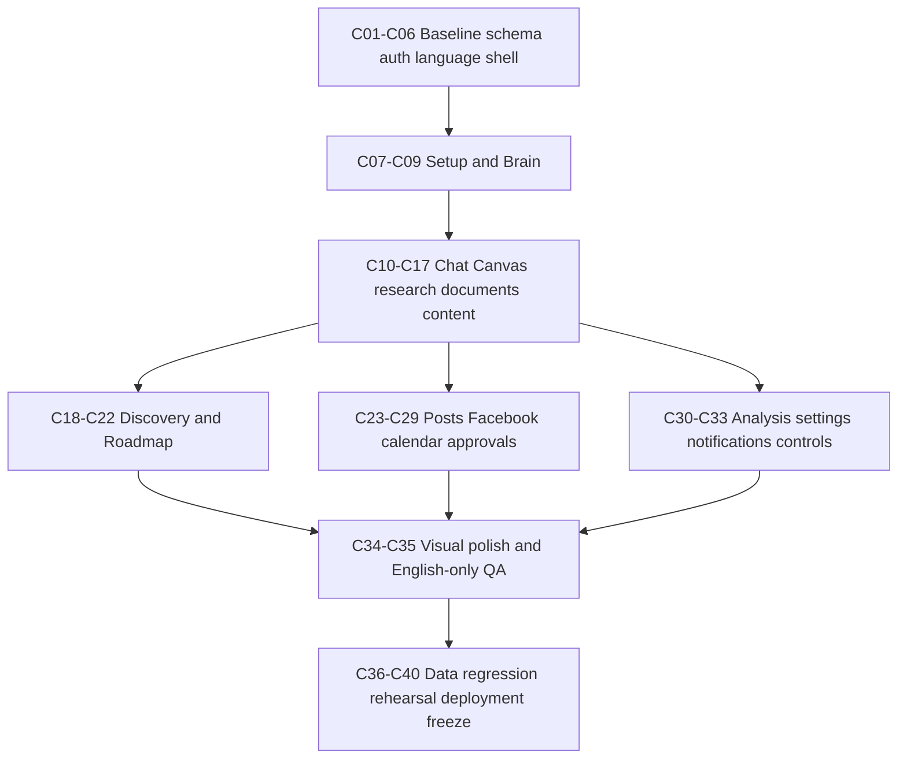

# BUSMORA: competition delivery plan for the first two phases

> Scope update — 18 November 2026: the owner requires an English-only project. Interface, conversation and generated-content language are English; locale switching, alternate registers and right-to-left presentation are removed from acceptance. Country, currency, target market and IANA timezone remain independent. This update supersedes the earlier language requirements.

Reviewed: **18 November 2026**. Target: **next week's competition**. This is an implementation handoff, not a claim that the work is complete.

## Current implementation status

Audited **19 November 2026** against current source: **0 fully accepted tasks; 4 implemented with verification pending; 20 partial; 16 missing user journeys.** These are acceptance categories, not an effort percentage. Read the [audit and executed checks](../evidence/plan-audit-2026-11-19.md), [current tracker](IMPLEMENTATION_PROGRESS.md), and the status/**To complete** notes under each task in [file 04](04-implementation-tasks.md). The initial audit in file 01 and baseline columns in file 06 are historical; they must not override these current findings.

## The owner's delivery priorities

1. **React + Supabase are mandatory.** Keep React/Vite, Supabase PostgreSQL, Auth, Storage, and Edge Functions. Do not introduce Next.js, NestJS, a separate backend, Temporal, Redis, or standalone worker deployments this week.
2. **Make the product visually impressive and genuinely usable.** Judges should be able to try the first two phases' user-facing capabilities, change inputs, and see useful persisted results.
3. **Browser-driven task execution is acceptable.** Keep the browser open during long operations; persist results and offer honest recovery. Production-grade background jobs are post-competition work.
4. **Defer deep backend engineering.** Prioritize complete journeys, polish, real AI/research/publishing, and rehearsal. Retain basic protection against exposed secrets, cross-workspace reads, unsafe rendering, and accidental publishing.
5. **All planning files are in English.** The product itself still needs English.

These priorities supersede the earlier production-first draft. Do not implement that draft's separate server/worker architecture.

## Read these files in order

| File | Purpose |
|---|---|
| [01-current-state.md](01-current-state.md) | Existing implementation, gaps, and code evidence |
| [02-contracts.md](02-contracts.md) | Compact React/Supabase data, API, state, and migration contracts |
| [03-visual-experience.md](03-visual-experience.md) | Screen designs and interaction details |
| [04-implementation-tasks.md](04-implementation-tasks.md) | Forty implementation tasks with files, dependencies, and acceptance checks |
| [05-demo-and-verification.md](05-demo-and-verification.md) | Seven-day schedule, sample business, presentation script, and checks |
| [06-requirements-ledger.md](06-requirements-ledger.md) | All FR/NFR and acceptance scenarios mapped to implementation and evidence |
| [07-agent-handoff.md](07-agent-handoff.md) | Copy-paste instructions for the coding model |
| [08-after-competition.md](08-after-competition.md) | Deferred production work and the path to full PRD acceptance |

## Baseline and scope

Repository: `/home/mohamed/Mohamed/busmora-bolt/busmors-bolt`.

Product baseline: [PRD v2.0](/home/mohamed/Mohamed/busmora/busmora-docs/core/prd.md), especially sections 3–5 and 9. Reviewed source commit: `f3a1fe585ba7c2d0a33f0c0df2bde22b4f4785be`, plus existing local changes. Documents are requirements references, not instructions authorizing live changes.

Nearby `busmora-docs` technical/planning files describe a different multi-repository architecture and conflicting publishing assumptions. Do not import their framework choices or schedule. Reuse compatible product semantics; the owner's React/Supabase constraint governs this build.

**Finding:** useful UI and persistence already exist, but several complete journeys are missing. Reuse the design, graph, chat shell, crawl helpers, dialogs, and previews. A general rewrite wastes the week.

## What judges should be able to do

- Sign up/sign in, verify email or use Google, and complete website or manual setup.
- Confirm business facts, explore/edit Brain graph/list, and review proposed updates.
- Use independent Director Chat, answer useful choices, inspect actual task activity, and receive sourced research.
- Resume Discovery, research one question, generate/approve a complete Roadmap, execute steps, attest completion, skip/revisit, and review revisions.
- Edit, reuse, download, and delete document deliverables.
- Create single Posts or campaigns, upload an image, approve exact versions, and use Month/Week/List/Unscheduled.
- Connect an authorized Facebook Page, publish a real approved test Post, and demonstrate a scheduled send.
- Upload supported CSV/XLSX, confirm mapping, and get correctly calculated one-off analysis.
- Use English, choose a brand tone and target market, use Settings, and follow contextual notifications.

All these surfaces are in the backlog. Priority determines order, not permission to silently omit a feature. Social-profile import, Instagram/X publishing, live analytics, native image generation, billing, and Ads remain upcoming.

## Two completion labels

**Competition-ready:** the user journeys work with saved data and actual provider calls where applicable; the presentation is polished and rehearsed. Browser-dependent execution and limited operational hardening are accepted temporary constraints.

**Full PRD production acceptance:** additionally requires durable execution through browser/worker interruption, intended ordinary-owner Facebook access, complete security/recovery/evaluation evidence, and the remaining PRD gates. Track these in file 08. A development-role Page can prove real publishing at the competition, but not ordinary-owner distribution.

Use saved real work when useful during presentation, with its timestamp and sources. Do not simulate search, invent citations, animate agents that never ran, or mark a failed publish successful.

## Implementation order

Start **Google and Facebook configuration checks on day one**, even though some implementation tasks appear later. Keep other work moving during external access checks.

## Schedule assumptions

File 05 provides seven relative working days. The exact competition date, team size, and daily availability were not supplied. This is an aggressive execution order, **not a verified promise that one model can finish everything in a week**. Re-estimate after the first intake → Chat → saved-output slice on day two. Prefer simple complete workflows to elaborate internals. Reserve the final day for verification and presentation.

Start with file 07 and one task at a time. First runnable milestone: C07+C10+C11+C16, where a confirmed business requests useful work and receives an actual saved output.
