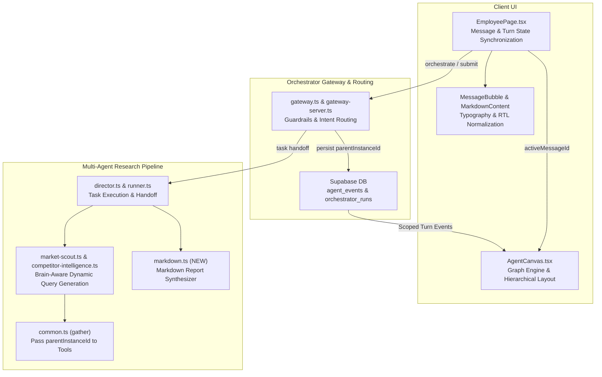

# Comprehensive Technical Master Plan: Fixing & Developing Chat Employee, Agent Canvas, and Research Pipeline
## Master Technical Plan: Chat Employee, Agent Canvas & Multi-Agent Research System

> **Document Purpose**:  
> This document represents an exhaustive, detailed technical implementation plan & architecture specification designed to resolve all visual, architectural, and data quality issues across the **Chat Employee** system and its three execution paths (**Direct**, **Brain**, and **Task**). This plan is crafted with meticulous precision to be handed over to any software engineer or AI coding agent to execute the required modifications step-by-step without ambiguity.

---

## Table of Contents
1. [Forensic Root Cause Analysis](#1-forensic-root-cause-analysis)
2. [Track 1: Direct – Fixing Canvas Layout & Message-Scoped Canvas](#2-track-1-direct--fixing-canvas-layout--message-scoped-canvas)
3. [Track 2: Brain – Tool Edge Connection & RTL List Bullets Overflow Fix](#3-track-2-brain--tool-edge-connection--rtl-list-bullets-overflow-fix)
4. [Track 3: Task – Canvas Architecture, Director Handoff, Scrape Node Cleanup, Query Engineering & JSON Leak Prevention](#4-track-3-task--canvas-architecture-director-handoff-scrape-node-cleanup-query-engineering--json-leak-prevention)
5. [Target Architecture & File Mapping](#5-target-architecture--file-mapping)
6. [Code-Level Implementation Specs](#6-code-level-implementation-specs)
7. [Verification & Test Plan](#7-verification--test-plan)

---

## 1. Forensic Root Cause Analysis

| Issue | Track | Code Location | Root Cause |
| :--- | :--- | :--- | :--- |
| **Unorganized, zigzag Canvas layout** | Direct | `src/components/chat/AgentCanvas.tsx` (L182-L185) | Primitive coordinate distribution based on modulo `index % 3`, placing the `You` node below the `Orchestrator` node, zigzagging downward and breaking rightward. |
| **Canvas accumulation on second message & floating orphan nodes** | Direct | `src/features/research/canvas/graph.ts` (L246-L254) + `EmployeePage.tsx` | The UI fetches all conversation events (`list_conversation_events`) at once. A second message spawns a new `orchestrator`, resulting in duplicate agent nodes; the `You` node only connects to the initial stale one while the second floats unattached. Furthermore, there is no concept of a "Message-scoped Canvas". |
| **Brain node floats without an edge connecting to Orchestrator** | Brain | `supabase/migrations/20261122120000_orchestrator_first.sql` (L72-L99) | The stored procedure `record_conversation_event` does not accept or persist `parent_instance_id`. When building the graph, the node has no parent (`parent = null`), so no edge is drawn connecting it to the Orchestrator. |
| **Bullet points overflow the chat bubble boundary in Arabic (RTL)** | Brain | `src/index.css` (L480-L496) | `.markdown-body ul` enforces a hardcoded `margin-left: 1.25rem` designed for LTR. In Arabic (RTL), lists flow from right to left, and the default `outside` marker without `padding-inline-start` pushes bullet points past the right border of the card. |
| **Director node disconnected from Orchestrator in Canvas** | Task | `graph.ts` (L230-L235) + `record_conversation_event` | The `delegation` event to the Director fails to persist `parent_instance_id` for the same reason above, leaving Director floating without an incoming edge from Orchestrator. |
| **15+ Scrape circles stuck in "running" state despite task completion** | Task | `src/features/research/canvas/graph.ts` (L107-L113) | `stateFromEvent` checks only `eventType === 'agent_completed'`, ignoring `status === 'completed'`. `tool_call` events arrive with event type `tool_call` and `status: 'completed'`; the check misses them, falling through to the default `return 'running'`, making them appear perpetually in-progress! |
| **Generic, nonsensical search queries (`saas`, `competitors in Egypt`)** | Task | `src/features/research/agents/market-scout.ts` (L100-L104) + `brief.ts` | Hardcoded static query strings like `['المنافسين في مصر', 'competitors in Egypt']` were used, and the company's domain was collapsed into a single generic taxonomy token (`saas`) rather than leveraging real Brain profile context (e.g., Wuilt, e-commerce store & website builder). |
| **Raw JSON object leaked into chat report text** | Task | `src/server/research/runner.ts` (L254 & L320) | The document content was assigned `JSON.stringify(report)` directly in the `content` field. The chat component then renders raw JSON text to the user instead of well-formatted human-readable Markdown. |

---

## 2. Track 1: Direct – Fixing Canvas Layout & Message-Scoped Canvas

### 2.1 Visual Layout Fix (Canvas Layout)
- **Current State**: The user node `You` appears at the bottom-left, while `Orchestrator` appears at the top-right, with a disjointed, zigzagging connecting line.
- **Engineering Solution**:
  - Adopt a clean **Hierarchical Top-to-Bottom Layout**:
    - Place the `You` node at the top-center: `x: 250, y: 30`.
    - Place the `Orchestrator` node directly underneath it vertically: `x: 250, y: 150`.
    - The connecting edge runs straight and vertically from the bottom handle of `You` to the top handle of `Orchestrator` via `straight` or `smoothstep` style without horizontal offset or breaks.

### 2.2 Message-Scoped Canvas
- **Current State**: All conversation events are rendered in a single ever-growing graph. When sending a new message, nodes accumulate and multiple Orchestrators appear.
- **Required Specification**:
  1. **Isolate Events by Message / Interaction Turn (Turn / Message Scope)**:
     - Each user message represents an interaction turn (`turn`) identified by a unique key: `messageId`, `runId`, or `correlationId`.
     - Link Canvas events (`agent_events`) to the corresponding message ID (`message_id` or `correlation_id`).
  2. **Clear Canvas on New Message (Clean Slate)**:
     - When the user sends a new message, the Canvas immediately transitions to display only the events of the new message (Clean Slate). The `You` node reflects the current message query and connects only to the `Orchestrator` of that active turn.
  3. **Interactive History Inspection**:
     - Introduce `activeMessageId` state in `EmployeePage`.
     - Clicking any previous message in the chat history (User Message or Agent Message) selects that message and updates the Canvas to display the graph and execution events associated specifically with that turn.
     - Add a subtle visual active highlight ring around the currently selected message.

---

## 3. Track 2: Brain – Tool Edge Connection & RTL List Bullets Overflow Fix

### 3.1 Connecting Brain Tool with an Edge from Orchestrator
- **Current Problem**: A circular `Brain` node floats unattached with no edge connecting it to Orchestrator, appearing disconnected and misplaced.
- **Engineering Solution**:
  1. **Pass and Persist `parent_instance_id`**:
     - Update the database stored procedure `record_conversation_event` to accept `p_parent_instance_id uuid`.
     - In `src/features/orchestrator/gateway.ts`, when invoking the Brain Tool, pass the Orchestrator's node instance ID as `parentInstanceId`.
     - `buildAgentGraph` will parse this relationship and construct a directed `tool_call` edge from `Orchestrator` to `Brain`.
  2. **Proximity Placement**:
     - Position the `Brain` node adjacent to the `Orchestrator` node (e.g., horizontal offset `+180px`, slight vertical offset `+20px`, or directly below when no Director is present).
     - Render a `tool_call` edge with distinct tool styling (amber/orange `#f59e0b` or light violet) with a clear direction indicating Orchestrator querying Brain and receiving results.

### 3.2 RTL List Bullets Overflow Fix
- **Current Problem**: In messages containing bulleted lists in Arabic (e.g., Wuilt profile summary), the bullet points (`•`) overflow past the right boundary of the chat bubble.
- **Fix in `src/index.css`**:
  Replace hardcoded LTR margins with CSS logical properties respecting reading direction:
  ```css
  /* Root fix in src/index.css */
  .markdown-body ul {
    list-style-type: disc;
    list-style-position: outside;
    padding-inline-start: 1.5rem; /* Ensures adequate clearance for bullets inside container in both RTL & LTR */
    padding-inline-end: 0;
    margin-inline-start: 0;
    margin-inline-end: 0;
    margin-left: 0; /* Remove legacy hardcoded margin-left */
    margin-top: 0.35rem;
    margin-bottom: 0.5rem;
  }

  .markdown-body ol {
    list-style-type: decimal;
    list-style-position: outside;
    padding-inline-start: 1.5rem;
    padding-inline-end: 0;
    margin-inline-start: 0;
    margin-inline-end: 0;
    margin-left: 0;
    margin-top: 0.35rem;
    margin-bottom: 0.5rem;
  }

  .markdown-body li {
    padding-inline-start: 0.25rem;
    margin-bottom: 0.25rem;
  }
  ```

---

## 4. Track 3: Task – Canvas Architecture, Director Handoff, Scrape Node Cleanup, Query Engineering & JSON Leak Prevention

### 4.1 Orchestrator to Director Connection
- **Root Cause**: The `delegation` event emitted by the Orchestrator omitted `parentInstanceId` or had it dropped during graph compilation.
- **Solution**:
  - Ensure the Director instantiation event carries `parent_instance_id = orchestratorId`.
  - In `graph.ts`, create an explicit `delegation` edge with prominent styling (`#7c3aed`) originating from the bottom of Orchestrator into the top of Director.

### 4.2 Resolving Cluttered Scrape Nodes & Stuck "Running" State
1. **Fixing Event Status Evaluation Bug**:
   - In `src/features/research/canvas/graph.ts` inside `stateFromEvent`:
     ```typescript
     // Before:
     function stateFromEvent(eventType: string, status: string | null | undefined): AgentNodeState {
       if (status === 'failed' || eventType === 'agent_error') return 'failed'
       if (status === 'partial') return 'partial'
       if (eventType === 'agent_completed') return 'completed' // BUG: ignores status === 'completed'!
       if (status === 'queued') return 'queued'
       return 'running' // All tool_calls fall through here and stay running!
     }

     // After:
     function stateFromEvent(eventType: string, status: string | null | undefined): AgentNodeState {
       if (status === 'failed' || eventType === 'agent_error') return 'failed'
       if (status === 'partial') return 'partial'
       if (status === 'completed' || eventType === 'agent_completed') return 'completed' // Fixed check
       if (status === 'queued') return 'queued'
       return 'running'
     }
     ```
2. **Refactoring Tool & Scraping Presentation on Canvas**:
   - **Current Flaw**: Every fetched page spawned an independent circular node, producing 15 redundant "Scrape" nodes in a tangled web.
   - **Target Clean Design**:
     - **Smart Tool Aggregation (Recommended)**:
       Instead of generating 15 independent scrape nodes, aggregate search and tool operations per subagent into a **single consolidated tool node attached to the agent** (e.g., one node attached to Market Scout labeled `Firecrawl (6 sources)` or `Web Research Tool`, displaying a counter of retrieved pages inside the card).
     - **Scope Tools Exclusively to Invoking Agent**:
       In `src/features/research/agents/common.ts`, `gather` must pass the calling subagent's actual instance ID (`context.instanceId`) as `parentInstanceId` rather than `null`. Tool edges will then branch cleanly and proximately from their responsible subagent rather than floating in space.

### 4.3 Eliminating Superficial Search Queries (`saas`, `competitors in Egypt`)
- **Root Cause**:
  - `src/features/research/agents/market-scout.ts` contained hardcoded strings:
    `...(round === 1 ? ['المنافسين في مصر', 'competitors in Egypt'] : [])`
  - `inferCategory` and `inferSector` matched only the first arbitrary keyword token (like `saas` from company description) while ignoring the actual business name and profile details from Brain.
- **Comprehensive Solution**:
  1. **Purge Generic Hardcoded Queries**: Remove static strings like `"competitors in Egypt"` and `"المنافسين في مصر"`.
  2. **Context-Aware Query Formulation from Brain**:
     - Read verified business profile from task context:
       - Company Name: `Wuilt`
       - Business Domain: `Website & E-commerce store builder platform`
       - Competitors / Alternatives noted in Brain: `Shopify, Salla, Zid, ExpandCart`
       - Target Geography: `Egypt and Saudi Arabia`
     - Formulate structured, high-intent query matrices combining:
       `[Product/Service Name] + [Search Intent / Competitor Comparison] + [Target Geography]`
     - Example generated queries:
       - `"بدائل ومنافسين منصات المتاجر الإلكترونية في مصر"`
       - `"مقارنة أسعار باقات إنشاء المتاجر في مصر"`
       - `"أفضل منصات التجارة الإلكترونية في مصر مثل Shopify و Wuilt"`
       - `"ecommerce store builders Egypt competitors pricing"`

### 4.4 Preventing Raw JSON Leakage & Formatting Reports as Human-Grade Markdown
- **Root Cause**:
  In `src/server/research/runner.ts` lines 254 and 320:
  `content: JSON.stringify(report).slice(0, 79000)`
  Raw JSON was passed directly into document content and chat messages!
- **Engineering Solution**:
  1. Create a dedicated synthesis formatter: `src/features/research/synthesis/markdown.ts`.
  2. Export `formatReportMarkdown(report: ResearchReport): string` converting the report structure into polished Markdown containing:
     - **Headline & Executive Brief** (Arabic narrative with key English industry terms).
     - **Competitor Landscape Matrix** (Competitor name, pricing model, strengths, weaknesses).
     - **Pricing & Tier Comparison** in the Egyptian market (including 14% VAT details where applicable).
     - **Audience Insights & Customer Voice** with identified market gaps.
     - **Strategic Action Plan & Experiment Proposals**.
     - **Audited Citations & Sources**.
  3. Store this formatted Markdown in `document.content`, preserving raw JSON solely in backend cache or storage payloads rather than display fields.

---

## 5. Target Architecture & File Mapping



### File Modification Inventory:

1. **`supabase/migrations/20261123100000_canvas_message_scoping.sql` (New Migration)**:
   - Update `record_conversation_event` to accept `p_parent_instance_id uuid` and `p_message_id uuid`.
   - Update `list_conversation_events` to support event filtering by message (`p_message_id`) or turn.
2. **`src/features/orchestrator/gateway.ts` & `src/server/orchestrator/gateway-server.ts`**:
   - Pass `parentInstanceId` when recording Brain and Director events.
   - Associate events with `message_id` or turn correlation ID.
3. **`src/features/research/canvas/graph.ts`**:
   - Fix `stateFromEvent` to evaluate `status === 'completed'`.
   - Implement hierarchical node linkage (You -> Orchestrator -> Brain/Director -> Subagents -> Tools).
   - Aggregate repetitive tool invocations per subagent rather than flooding the canvas with isolated scrape nodes.
4. **`src/components/chat/AgentCanvas.tsx`**:
   - Remove legacy `index % 3` modulo positioning.
   - Implement clean hierarchical tree layout aligning the edge between `You` and `Orchestrator` vertically straight.
5. **`src/screens/EmployeePage.tsx`**:
   - Introduce `activeMessageId` state.
   - Enable clicking historical messages to inspect that specific message's Canvas state.
   - Automatically reset Canvas and display latest query upon sending a new message.
6. **`src/index.css`**:
   - Refactor `.markdown-body ul` and `.markdown-body ol` to use `padding-inline-start: 1.5rem` and remove fixed `margin-left` to resolve RTL list bullet overflows.
7. **`src/server/research/runner.ts`**:
   - Replace `JSON.stringify(report)` with synthesized Markdown in report cards and full-view modals.
8. **`src/features/research/synthesis/markdown.ts` (New File)**:
   - Report serialization module rendering structured JSON into professional Markdown in Arabic and English.
9. **`src/features/research/agents/market-scout.ts` & `brief.ts`**:
   - Eliminate hardcoded query strings; formulate targeted queries grounded in verified Brain profile data.
10. **`src/features/research/agents/common.ts`**:
    - Pass `context.instanceId` as `parentInstanceId` for `tool_call` events so tool nodes attach to their parent subagent.

---

## 6. Code-Level Implementation Specs

### 6.1 Database Migration
New migration file: `supabase/migrations/20261123100000_canvas_message_scoping.sql`:
```sql
-- 1. Add parent_instance_id and message_id to record_conversation_event
CREATE OR REPLACE FUNCTION record_conversation_event(
  p_conversation_id uuid,
  p_instance_id uuid,
  p_event_type text,
  p_agent_id text,
  p_agent_role text,
  p_label text,
  p_status text,
  p_public_message text,
  p_parameters jsonb,
  p_failure_reason text,
  p_started_at timestamptz,
  p_ended_at timestamptz,
  p_parent_instance_id uuid DEFAULT NULL,
  p_message_id uuid DEFAULT NULL
) RETURNS uuid LANGUAGE plpgsql SECURITY DEFINER SET search_path=public AS $$
DECLARE w uuid:=auth.uid(); v_seq bigint; v_id uuid;
BEGIN
  IF w IS NULL THEN RAISE EXCEPTION 'NOT_AUTHENTICATED'; END IF;
  IF NOT EXISTS(SELECT 1 FROM conversations WHERE workspace_id=w AND id=p_conversation_id) THEN RAISE EXCEPTION 'NOT_FOUND'; END IF;
  
  PERFORM pg_advisory_xact_lock(hashtextextended('conv:'||p_conversation_id::text,0));
  SELECT coalesce(max(seq),0)+1 INTO v_seq FROM agent_events WHERE conversation_id=p_conversation_id;
  
  INSERT INTO agent_events(
    workspace_id, task_id, conversation_id, instance_id, parent_instance_id,
    correlation_id, seq, event_type, agent_id, agent_role,
    public_message, redacted_parameters, failure_reason, started_at, ended_at, payload
  )
  VALUES(
    w, NULL, p_conversation_id, coalesce(p_instance_id, gen_random_uuid()), p_parent_instance_id,
    p_message_id, v_seq, p_event_type, p_agent_id, coalesce(p_agent_role,'subagent'),
    coalesce(p_public_message,''), coalesce(p_parameters,'{}'::jsonb),
    p_failure_reason, coalesce(p_started_at, now()), p_ended_at,
    jsonb_build_object(
      'task_summary', p_label,
      'label', p_label,
      'agent_role', coalesce(p_agent_role,'subagent'),
      'status', p_status,
      'public_message', coalesce(p_public_message,''),
      'parent_instance_id', p_parent_instance_id
    )
  )
  RETURNING id INTO v_id;
  RETURN v_id;
END $$;
```

---

### 6.2 CSS RTL List Bullets Fix in `src/index.css`
Replace lines 480-496 with:
```css
.markdown-body ul,
.markdown-body ol {
  padding-inline-start: 1.5rem;
  padding-inline-end: 0;
  margin-inline-start: 0;
  margin-inline-end: 0;
  margin-left: 0;
  margin-top: 0.35rem;
  margin-bottom: 0.5rem;
}

.markdown-body ul {
  list-style-type: disc;
}

.markdown-body ol {
  list-style-type: decimal;
}

.markdown-body li {
  margin-bottom: 0.25rem;
}
```

---

### 6.3 Agent State Evaluation & Graph Building in `src/features/research/canvas/graph.ts`
1. **Fix `stateFromEvent` Function**:
```typescript
function stateFromEvent(eventType: string, status: string | null | undefined): AgentNodeState {
  if (status === 'failed' || eventType === 'agent_error') return 'failed'
  if (status === 'partial') return 'partial'
  if (status === 'completed' || eventType === 'agent_completed') return 'completed'
  if (status === 'queued') return 'queued'
  return 'running'
}
```
2. **Turn Isolation & `You` Node Hookup**:
```typescript
// Inside buildAgentGraph: Connect You to the correct Orchestrator for the active turn
const userMessage = (input.userMessage ?? '').trim()
if (userMessage) {
  // Select the orchestrator matching the active turn instead of an arbitrary first node
  const targetOrchestrator = input.activeOrchestratorId 
    ? nodes.get(input.activeOrchestratorId) 
    : [...nodes.values()].reverse().find(node => node.kind === 'orchestrator')

  if (targetOrchestrator && !nodes.has('user')) {
    nodes.set('user', {
      id: 'user', instanceId: null, kind: 'user', agentId: 'user', label: 'You', objective: 'You',
      state: 'completed', icon: ICONS.user, color: COLORS.user, sources: 0, consumption: emptyUsage(),
      startedAt: null, endedAt: null, failureReason: null, parametersRedacted: {}, messages: [userMessage], order: -1,
    })
    edges.push({ id: `edge:user:${targetOrchestrator.id}`, from: 'user', to: targetOrchestrator.id, kind: 'flow', message: '', animated: false })
  }
}
```

---

### 6.4 Hierarchical Layout Algorithm in `src/components/chat/AgentCanvas.tsx`
Replace arbitrary modulo `index % 3` with structured hierarchical tree positioning:
```typescript
// Hierarchical Top-to-Bottom Layout Computation
function computeLayout(graph: CanvasGraph, userPositions: Record<string, { x: number; y: number }>) {
  const positions: Record<string, { x: number; y: number }> = {}
  const centerX = 300

  // 1. You node at the top
  if (graph.nodes.some(n => n.id === 'user')) {
    positions['user'] = userPositions['user'] ?? { x: centerX, y: 30 }
  }

  // 2. Orchestrator node directly beneath You
  const orchestrator = graph.nodes.find(n => n.kind === 'orchestrator')
  if (orchestrator) {
    positions[orchestrator.id] = userPositions[orchestrator.id] ?? { x: centerX, y: 150 }
  }

  // 3. Brain tool positioned cleanly adjacent to Orchestrator
  const brainNode = graph.nodes.find(n => n.agentId === 'brain')
  if (brainNode && orchestrator) {
    positions[brainNode.id] = userPositions[brainNode.id] ?? { x: centerX + 180, y: 150 }
  }

  // 4. Task path: Director positioned vertically below Orchestrator
  const directorNode = graph.nodes.find(n => n.kind === 'director')
  if (directorNode) {
    positions[directorNode.id] = userPositions[directorNode.id] ?? { x: centerX, y: 270 }
  }

  // 5. Specialized subagents distributed horizontally below Director
  const subagents = graph.nodes.filter(n => n.kind === 'subagent')
  const totalSubagents = subagents.length
  const spacingX = 220
  const startX = centerX - ((totalSubagents - 1) * spacingX) / 2

  subagents.forEach((sub, idx) => {
    const subX = totalSubagents === 1 ? centerX : startX + idx * spacingX
    const subY = 400
    positions[sub.id] = userPositions[sub.id] ?? { x: subX, y: subY }

    // 6. Tools invoked by this subagent positioned directly below it
    const childTools = graph.nodes.filter(n => n.kind === 'tool' && n.parentInstanceId === sub.instanceId)
    childTools.forEach((tool, tIdx) => {
      positions[tool.id] = userPositions[tool.id] ?? { x: subX, y: subY + 90 + tIdx * 70 }
    })
  })

  // 7. Auditor & Synthesis at base
  const auditor = graph.nodes.find(n => n.kind === 'auditor')
  const synthesis = graph.nodes.find(n => n.kind === 'synthesis')
  if (auditor) positions[auditor.id] = userPositions[auditor.id] ?? { x: centerX - 120, y: 650 }
  if (synthesis) positions[synthesis.id] = userPositions[synthesis.id] ?? { x: centerX + 120, y: 650 }

  return positions
}
```

---

### 6.5 State Management in `src/screens/EmployeePage.tsx`
1. Add `activeMessageId` state:
```typescript
const [activeMessageId, setActiveMessageId] = useState<string | null>(null)
```
2. When sending a new message:
```typescript
const send = async (text: string) => {
  // ...
  setActiveMessageId(null) // Reset selection to immediately focus active turn
  // ...
}
```
3. When rendering chat messages, support click selection to inspect that turn's graph:
```tsx
<div 
  onClick={() => setActiveMessageId(msg.id)}
  className={`cursor-pointer transition-all ${activeMessageId === msg.id ? 'ring-2 ring-primary-500 rounded-2xl' : ''}`}
>
  <MessageBubble msg={msg} ... />
</div>
```
4. Pass message-filtered events to `AgentCanvas`:
```typescript
const filteredEvents = useMemo(() => {
  if (!activeMessageId) {
    // Default: display latest turn events only
    return eventsOfLatestTurn(events)
  }
  return eventsOfMessage(events, activeMessageId)
}, [events, activeMessageId])
```

---

### 6.6 Search Query Optimization in `market-scout.ts`
Replace lines 100-104:
```typescript
// Remove legacy hardcoded strings:
// ...(round === 1 ? ['المنافسين في مصر', 'competitors in Egypt'] : [])

// Formulate dynamic queries from businessProfile context:
const companyName = brief.businessProfile.name !== 'The business' ? brief.businessProfile.name : ''
const coreOffering = brief.category.labelAr || brief.category.label
const targetGeo = geography.join(' ') || 'مصر'

const smartQueries = [
  `${coreOffering} ${targetGeo}`,
  `منافسين ${coreOffering} في ${targetGeo}`,
  companyName ? `بدائل ${companyName} في ${targetGeo}` : '',
  `أسعار باقات ${coreOffering} ${targetGeo}`,
  `${brief.category.label} competitors ${brief.geography.governorates[0] ?? 'Egypt'}`
].filter(Boolean)
```

---

### 6.7 Markdown Report Synthesis in `src/server/research/runner.ts`
Create `src/features/research/synthesis/markdown.ts`:
```typescript
import type { ResearchReport } from './report'

export function formatReportMarkdown(report: ResearchReport): string {
  const { executiveBrief, scope, sections, claims, citations } = report

  return `
# ${executiveBrief.headlineAlt || executiveBrief.headline}

> **Scope**: ${scope.geography} | **Date**: ${scope.period} | **Mode**: ${scope.mode}

---

## 📌 Executive Summary
${executiveBrief.decisionAlt || executiveBrief.decision}

${sections.find(s => s.id === 'executive')?.bodyAlt || sections.find(s => s.id === 'executive')?.body || ''}

---

## 🏢 Competitive Landscape
${sections.find(s => s.id === 'competitors')?.bodyAlt || sections.find(s => s.id === 'competitors')?.body || ''}

---

## 💰 Pricing & Tier Comparison
${sections.find(s => s.id === 'pricing')?.bodyAlt || sections.find(s => s.id === 'pricing')?.body || ''}

---

## 🎯 Target Audience Insights & Market Gaps
${sections.find(s => s.id === 'audience')?.bodyAlt || sections.find(s => s.id === 'audience')?.body || ''}

---

## 🚀 Strategic Recommendations & Experiments
${sections.find(s => s.id === 'recommendations')?.bodyAlt || sections.find(s => s.id === 'recommendations')?.body || ''}

---

## 📚 Audited Citations & References
${citations.map((c, i) => `${i + 1}. [${c.title}](${c.url}) - *(Provider: ${c.provider})*`).join('\n')}
`.trim()
}
```

And in `src/server/research/runner.ts` lines 254 & 320:
```typescript
// Replace JSON.stringify(report) with:
const markdownReport = formatReportMarkdown(report)

document: {
  title: report.executiveBrief.headlineAlt || report.executiveBrief.headline || 'Market Research Report',
  content: markdownReport,
  type: 'research_report'
}
```

---

## 7. Verification & Test Plan

### 7.1 Track 1: Direct Verification
- [ ] **First Turn Visual Validation**:
  - Send `"Hello"` or `"Salam"`.
  - Verify that `You` appears at top-center and `Orchestrator` directly below it, connected by a vertical straight line.
- [ ] **Second Turn Interaction**:
  - Send a follow-up message like `"Hi again"`.
  - Verify that stale nodes are cleared and duplicate Orchestrators do not appear.
  - Verify that the `You` node displays the new message query text.
- [ ] **Historical Turn Inspection**:
  - Click on the first message in the chat history -> Verify Canvas renders the first message's graph.
  - Click on the second message -> Verify Canvas updates to show the second message's graph.

### 7.2 Track 2: Brain Verification
- [ ] **Company Profile Retrieval**:
  - Send query: `"What do you know about my business?"`.
  - Verify `Brain` node appears adjacent to or below `Orchestrator`, connected by a clean directed edge originating from `Orchestrator`.
- [ ] **RTL List Bullets Formatting**:
  - Inspect Arabic bulleted lists to confirm all bullets (`•`) render strictly inside the card boundaries with no overflow past the right margin.

### 7.3 Track 3: Task Verification
- [ ] **Director Handoff Edge**:
  - Request: `"Run a competitive research in Cairo"`.
  - Verify an explicit delegation edge is drawn from `Orchestrator` to `Director`.
- [ ] **Tool Nodes Appearance & Status**:
  - Verify tool/scrape nodes transition to green completed state (Done) upon finish instead of remaining stuck in "running".
  - Verify tool nodes branch from their invoking subagent in clean hierarchical order.
- [ ] **Query Quality Inspection**:
  - Verify search query logs contain zero generic fallback queries like `"competitors in Egypt"` in isolation, and instead formulate domain-specific queries (store builders, e-commerce platforms).
- [ ] **Report Document Content**:
  - Verify 100% absence of raw JSON strings (`{"id":"report:...}`) in the chat view or document preview modal.
  - Verify presentation of clean, formatted Markdown with structured tables, headers, and clickable citations.
